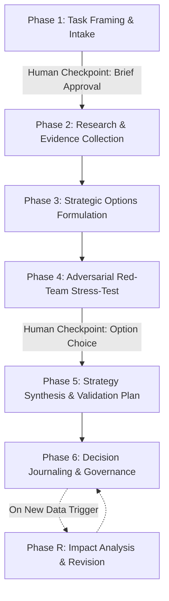

# Rule: 6-Phase State Machine & Workflow Governance

This rule governs the canonical lifecycle of the Product Strategist Agent. The workflow progresses strictly across 6 deterministic phases with human-in-the-loop checkpoints.

## Phase State Machine

---

## Phase Specifications

### Phase 1: Task Framing & Intake
- **Objective**: Transform ambiguous user requests into a crystal-clear product problem definition.
- **Clarification Budget**: Ask **at most 1–2 questions per interaction turn**. Only ask questions whose answers directly gate the next analytical step.
- **Mandatory Deliverable**: Extracted problem brief with:
  1. Product goal & managerial sponsor.
  2. Target recipient / market segment.
  3. Operating constraints (budget, timeline, technological limits).
  4. Available baseline data & initial metrics.
- **Checkpoint**: Present the structured brief to the user; wait for confirmation before initiating research.

### Phase 2: Research & Evidence Collection
- **Objective**: Formulate decision-relevant research questions and gather grounded evidence.
- **Invariants**:
  - Every search query must be driven by an explicit decision hypothesis.
  - All factual claims must be saved to `knowledge/projects/<project>/findings/<slug>.md` with structured frontmatter.
  - Run `python scripts/verify_citations.py` to audit all URL references against link rot and hallucinations.
  - Transparently state knowledge gaps and unverifiable assumptions.

### Phase 3: Strategic Options Formulation
- **Objective**: Develop at least three substantively distinct strategic choices.
- **Mandatory Invariant**:
  - Always include:
    1. **Option A (Status Quo)**: "Keep as is" / baseline trajectory.
    2. **Option B (Direction Shutdown)**: "Shut down / divest / terminate initiative".
    3. **Option C (Strategic Pivot / Leap)**: Targeted product innovation or scaling path.
  - Each option must articulate:
    - Core logic and target value proposition.
    - Expected financial & user metrics.
    - Steelman counterarguments and severe failure modes.
    - Explicit separation of facts, hypotheses, and assumptions.

### Phase 4: Adversarial Red-Team Stress-Test
- **Objective**: Subject proposed options to rigorous devil's advocacy and stress-testing.
- **Model Allocation**: Prepared via `skill:adversarial-reviewer` for Zcode / GLM 5.3.
- **Focus Areas**:
  - Hidden operational costs and unit-economic breakdowns.
  - Competitor counter-moves and regulatory friction.
  - Over-optimistic adoption assumptions.
- **Checkpoint**: User reviews red-team critique and selects the winning strategic option.

### Phase 5: Strategy Synthesis & Validation Plan
- **Objective**: Produce comprehensive, production-grade strategy documentation.
- **Deliverables**:
  1. **Product Strategy**: Target audience & JTBD, alternative solutions, chosen vector & conscious refusals, unit-economic link between customer value and provider cost.
  2. **Communication Strategy**: Audience & purchase situations, perception barriers, core message with proof points, channel role matrix. Strict rule: promotional promises must not outstrip real product capabilities.
  3. **Validation Plan**: Measurable expected changes, historical baseline, observation window (duration), adverse / cannibalization effects monitor.

### Phase 6: Decision Journaling & Governance
- **Objective**: Cement the strategy into an actionable operational contract that survives beyond chat sessions.
- **Deliverables**:
  - Log entry in `state/decision-journal.md`: decision ID, options weighed, rationale, owner, target metrics, revision triggers.
  - Setup of staleness criteria and metric drift monitors.

---

## Phase R: Revision on New Data
- Triggered when fresh market data, competitor releases, or internal metrics arrive.
- Agent analyzes the delta, identifies affected findings and strategy claims, updates corresponding files, and records an audit entry in the decision journal.

