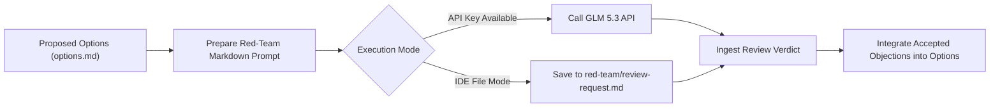

# Skill: Adversarial Reviewer (Red-Team)

## Overview
The `adversarial-reviewer` skill coordinates adversarial stress-testing. Using model diversity (GLM 5.3 hosted in Zcode or via API), it subjects proposed options to hostile executive review.

---

## Operational Workflow

---

## Execution Instructions

### Step 1: Prepare Red-Team Review Prompt
Using `knowledge/methodology/red-team/adversarial-review-prompt.md`, populate:
- `{{PROJECT_NAME}}`: Active project name.
- `{{BASELINE_METRICS_TABLE}}`: Current ground-truth metrics.
- `{{STRATEGIC_OPTIONS_TEXT}}`: Full text of Option A, Option B, Option C.

### Step 2: Execute Red-Team Audit
- **Mode A (API)**: If `GLM_API_KEY` is set in `.env`, trigger the API directly.
- **Mode B (Zcode File)**: Save the prompt to `knowledge/projects/<project>/red-team-review-request.md` for Zcode execution, and read back the resulting critique.

### Step 3: Synthesize Red-Team Findings
1. Identify the top lethal failure modes flagged by the red-team.
2. Ingest accepted mitigations into `knowledge/projects/<project>/output/options.md`.
3. Present the red-team verdict to the user for strategic choice ratification.

