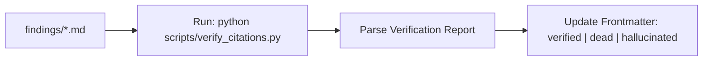

# Skill: Citation Verifier

## Overview
The `citation-verifier` skill provides automated anti-hallucination verification. Grounded in research showing 3–13% hallucinated links in LLM reports (arXiv:2504.00317), this skill audits every external reference.

---

## Operational Workflow



---

## Execution Instructions

### Step 1: Execute Python Verifier
Run the deterministic verification utility:
```bash
python scripts/verify_citations.py --project <project_name>
```

### Step 2: Evaluate Results
The script performs HTTP HEAD/GET checks and outputs:
- **Verified URLs (HTTP 200)**: Marked `verified: verified`.
- **Broken / 404 URLs**: Marked `verified: dead`.
- **Non-existent / Fabricated domains**: Marked `verified: hallucinated`.

### Step 3: Enforce Strategy Quarantine
- Any finding marked `dead` or `hallucinated` is immediately quarantined.
- The agent must notify the product lead and eliminate or replace the quarantined claim before proceeding to strategic option synthesis.

