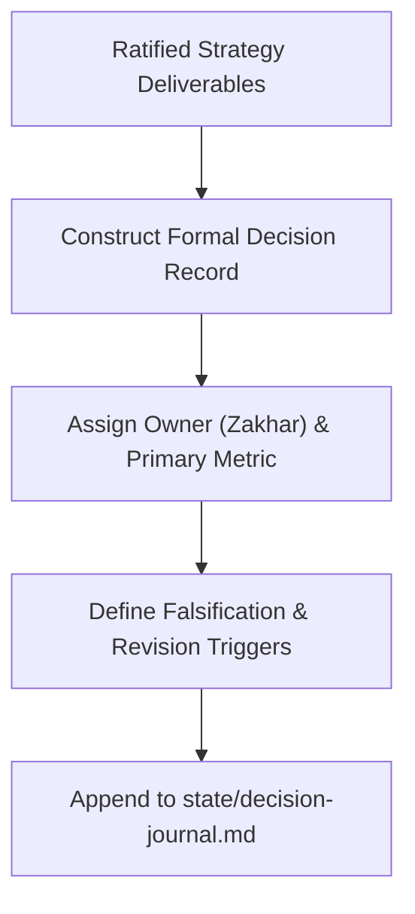

# Skill: Decision Journal

## Overview
The `decision-journal` skill provides long-term operational governance. It ensures strategic decisions survive beyond temporary chat sessions by establishing a binding operational contract in `state/decision-journal.md`.

---

## Operational Workflow

---

## Execution Instructions

### Step 1: Compose Decision Record
Create a standardized log entry containing:
- **Decision ID**: Unique code (e.g. `DEC-2026-MF-01`).
- **Timestamp**: Current ISO-8601 UTC timestamp.
- **Project**: Target project identifier.
- **Options Weighed**: Summary of evaluated paths (Status Quo, Shutdown, Chosen Leap).
- **Selected Option & Core Grounds**: Concise economic justification.
- **Accepted Counterarguments**: Key red-team risks integrated into operational design.
- **Owner**: Sole responsible maker (Zakhar).
- **Primary Metric**: Target KPI and milestone deadline.
- **Revision Trigger**: Explicit conditions mandating re-evaluation (e.g., "Active groups $<5,500$ after 60 days" or "Competitor launches zero-cost family sharing").

### Step 2: Append to Decision Journal
Append the entry to `state/decision-journal.md`.

