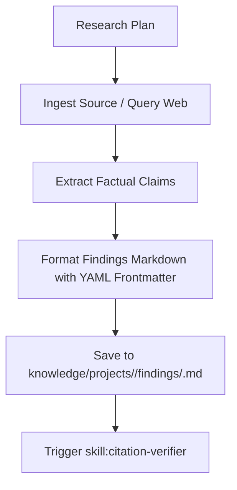

# Skill: Evidence Collector

## Overview
The `evidence-collector` skill systematically gathers empirical evidence from open data sources, PDF briefs, tabular metrics, and web reports. It enforces the repository's strict per-claim citation standard.

---

## Operational Workflow



---

## Execution Instructions

### Step 1: Source Ingestion & Claim Extraction
1. For local briefs or PDFs, read the text directly (or run `python scripts/extract_brief.py`).
2. For external web research, formulate targeted search queries.
3. Isolate discrete factual assertions (e.g. "Russian mobile operators saw family tariff adoption grow by 14% in 2025").

### Step 2: Frontmatter File Generation
Save every claim to an individual file in `knowledge/projects/<project>/findings/<slug>.md` using the exact YAML frontmatter format:
```yaml
---
claim: "Exact single-sentence factual assertion"
source_url: "https://example.com/verified-source"
verified: pending
confidence: fact
date_checked: "YYYY-MM-DD"
author: "Authoritative Organization"
data_period: "2025"
---

### Source Excerpt
> "...verbatim quote or tabular data..."

### Relevance to Strategy
Analysis of how this fact constrains or supports the strategic decision.
```

### Step 3: Handoff to Verification
Immediately invoke `skill:citation-verifier` to validate URLs and prevent hallucination leaks.

