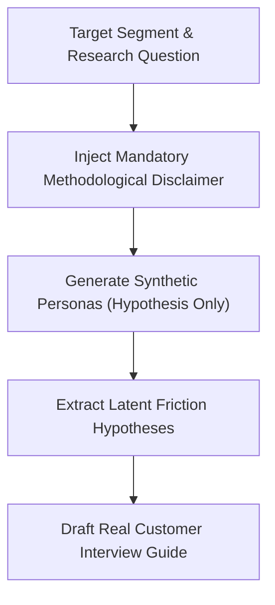

# Skill: Interview Panel & Synthetic Exploration

## Overview
The `interview-panel` skill provides qualitative user exploration while strictly abiding by the scientific honesty standard. It generates synthetic personas for hypothesis generation and drafts structured discussion guides for real customer research.

---

## Operational Workflow



---

## Execution Instructions

### Step 1: Mandatory Disclaimer Injection
Every generated artifact MUST begin with the verbatim disclaimer:
```markdown
> [!WARNING]
> **METHODOLOGICAL DISCLAIMER: SYNTHETIC PERSONA SIMULATION**
> This respondent profile and dialogue is generated synthetically via LLM simulation for **qualitative hypothesis generation and blind-spot identification ONLY**.
> Under our scientific evidence standards (arXiv:2507.04438), synthetic responses **DO NOT** constitute empirical evidence of consumer demand, behavioral willingness-to-pay, or market validation. Real user verification remains mandatory.
```

### Step 2: Persona Simulation (Blind-Spot Discovery)
Simulate 2–3 distinct archetypes (e.g., "Pragmatic Head of Household", "Privacy-Sensitive Teenager", "Elderly Parent with Feature Phone") to uncover latent friction, onboarding anxieties, and cognitive resistance.

### Step 3: Real Customer Interview Guide
Convert uncovered friction points into a rigorous 5-stage qualitative interview guide for real human interviews:
1. Context & current telecom setup.
2. Financial & organizational management of family connectivity.
3. Unpacking recent moments of frustration or surprise charges.
4. Concept reaction & cognitive objection exploration.
5. Debrief & actual behavioral validation.

