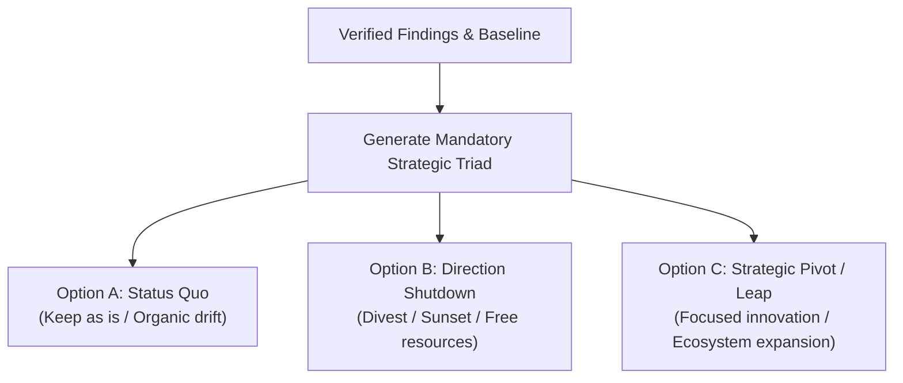

# Skill: Options Generator

## Overview
The `options-generator` skill prevents confirmation bias by mandating the simultaneous formulation of at least three fundamentally distinct strategic vectors.

---

## Mandatory Triad Standard

---

## Execution Instructions

### Step 1: Formulate Options
For the active project, compose three distinct paths:
1. **Option A (Status Quo)**: Continue baseline trajectory without new product investment.
2. **Option B (Direction Shutdown)**: Terminate initiative, migrate existing users to standard individual tariffs, eliminate dedicated marketing spend, and reallocate team.
3. **Option C (Strategic Leap / Value Pivot)**: Redesign positioning, eliminate core friction points, bundle high-value multi-SIM / smart device services.

### Step 2: Rigorous Steelman Objections
Every option must be accompanied by its strongest possible counterarguments:
- What are the lethal economic or operational vulnerabilities?
- Where will the initiative fail if consumer behavior deviates slightly?

### Step 3: Epistemic Separation
Explicitly classify all statements into:
- `[FACT]`: Historical data and verified research findings.
- `[HYPOTHESIS]`: Expected causal relationships.
- `[ASSUMPTION]`: Modeling parameters.

### Step 4: Deliverable Output
Write output to `knowledge/projects/<project>/output/options.md` and present to user.

