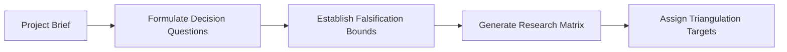

# Skill: Research Planner

## Overview
The `research-planner` skill translates a confirmed product brief into an actionable, decision-driven research plan. It guarantees that every inquiry directly informs a future strategic choice.

---

## Operational Workflow

---

## Step 1: Decision-Driven Question Formulation
For each strategic aspect of the brief, formulate questions that strictly pass the **Decision-Relevance Test**:
- *"If the answer is X, which strategic option is favored?"*
- *"If the answer is Y, which strategic option is refuted?"*

Examples for Telecom / Family Services:
- What is the real cannibalization rate when individual subscribers migrate to shared family pools?
- What are competitor price points for additional connected SIMs (smart watches, tablets, IoT)?
- What is the average household retention increase (months of life) when 2+ lines are merged?

---

## Step 2: Establish Gap & Boundary Disclosures
Identify upfront what information is publicly observable vs. proprietary:
- **Observable**: Public operator tariffs, regulatory filings, third-party analytics reports (Rosstat, TelecomDaily, TAdviser).
- **Proprietary**: Competitor internal cohort retention curves, exact gross margin per MVNO subscriber.

---

## Step 3: Research Plan Output
Generate a structured research plan file at `knowledge/projects/<project>/research-plan.md` listing:
1. Priority inquiries.
2. Proposed query vectors.
3. Required source triangulation pairs.
4. Delegation handoff to `skill:evidence-collector`.

