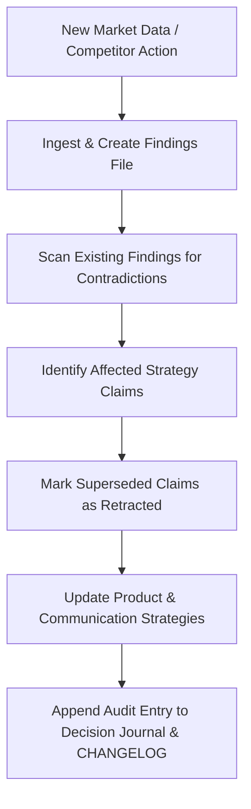

# Skill: Revision Scanner

## Overview
The `revision-scanner` skill provides continuous post-decision intelligence. When new data arrives (e.g., quarterly earnings, competitor tariff launches, regulatory updates), it traces downstream impact across previous findings and strategies.

---

## Operational Workflow

---

## Execution Instructions

### Step 1: Ingest New Data
1. Write the new evidence to `knowledge/projects/<project>/findings/<slug>.md`.
2. Run `python scripts/verify_citations.py` to confirm authenticity.

### Step 2: Downstream Impact Analysis
Scan `knowledge/projects/<project>/output/` for impacted assertions:
- Does the new data invalidate an assumption?
- Does competitor pricing breach our conscious refusal boundaries?

### Step 3: Execute Controlled Revision
1. Update affected strategy sections with timestamped revision notices.
2. Retract outdated findings per `.agents/rules/knowledge.md`.
3. Append a formal revision log entry in `state/decision-journal.md` and `docs/CHANGELOG.md`.

