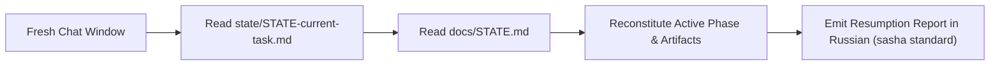

# Skill: Session Resume (Context Bootstrap)

## Overview
The `session-resume` skill enables seamless continuity across chat sessions or IDE restarts. It reads `state/STATE-current-task.md`, reconstitutes the cognitive state, and guides the user to the immediate next step.

---

## Operational Workflow



---

## Execution Instructions

### Step 1: Read State Pointers
In a fresh chat session, immediately inspect:
1. `state/STATE-current-task.md`
2. `docs/STATE.md`
3. Active project brief at `knowledge/projects/<project>/brief.md`

### Step 2: Formulate Resumption Status
Determine:
- Current active phase (Phase 1 through 6).
- Completed milestones and generated artifacts.
- Exact pending question or next action.

### Step 3: Present Status to Product Lead
Emit a concise, human Russian resumption status conforming to the `sasha` communication standard:
```markdown
Контекст работы успешно восстановлен из `state/STATE-current-task.md`:
- Проект: **[Project Name]**
- Текущая фаза: **[Phase Name]**
- Последнее действие: [Краткое описание выполненного шага]
- Следующий шаг: [Конкретное действие или вопрос, готовый к исполнению]
```

