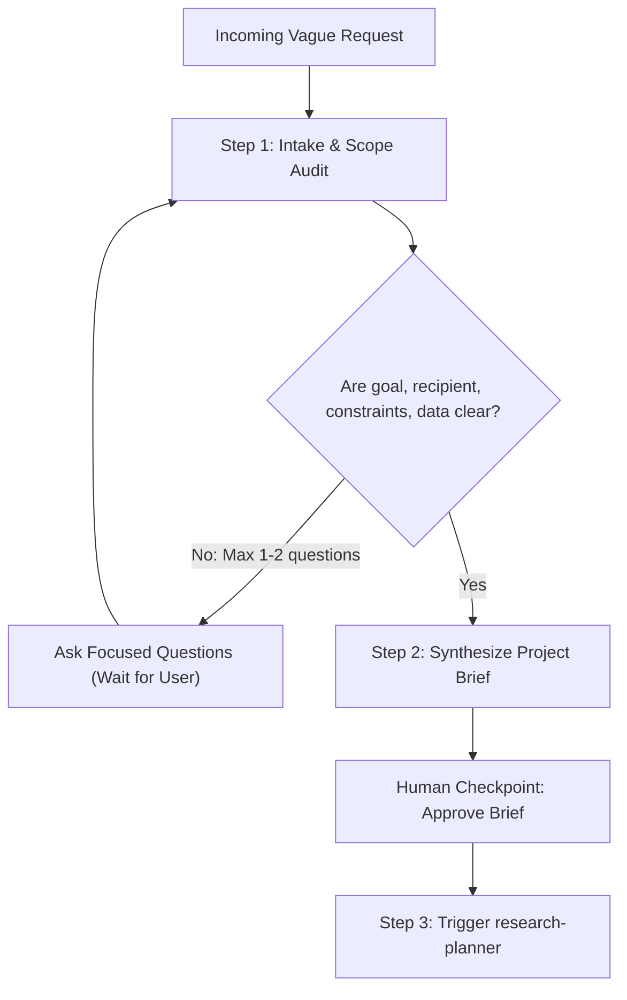

# Skill: Strategist (Master Orchestration & Intake)

## Overview
The `strategist` skill is the primary entry point of the repository agent. It orchestrates the full analytical lifecycle across all 6 phases and governs the intake clarification loop with human product leads.

---

## Operational Workflow

---

## Step 1: Intake Clarification Loop
1. Parse the incoming request against the four essential brief pillars:
   - **Goal & Managerial Sponsor**: What specific metric or business problem needs resolution? Who owns the outcome?
   - **Target Recipient / Segment**: Who is the intended customer or user base?
   - **Operating Constraints**: Budget ceilings, deadlines, technical or regulatory boundaries.
   - **Available Baseline Data**: What metrics or tables are already known?
2. **Clarification Budget**: Ask **at most 1–2 questions per turn**. Only ask questions whose answers directly gate the next analytical step. Avoid speculative or open-ended philosophical queries.
3. Tone and language must strictly follow Russian conversational standards (`sasha` standard).

---

## Step 2: Brief Synthesis & Normalization
Once clarity is reached:
1. Write or update `knowledge/projects/<project>/brief.md` using the canonical schema.
2. Update `state/STATE-current-task.md` with active project ID, goal, and phase status.
3. Log step tokens and estimated cost into `state/cost-log.csv`.

---

## Step 3: Pipeline Delegation
Guide the workflow to the next phase:
- Invoke `research-planner` to decompose the goal into decision-relevant inquiries.

