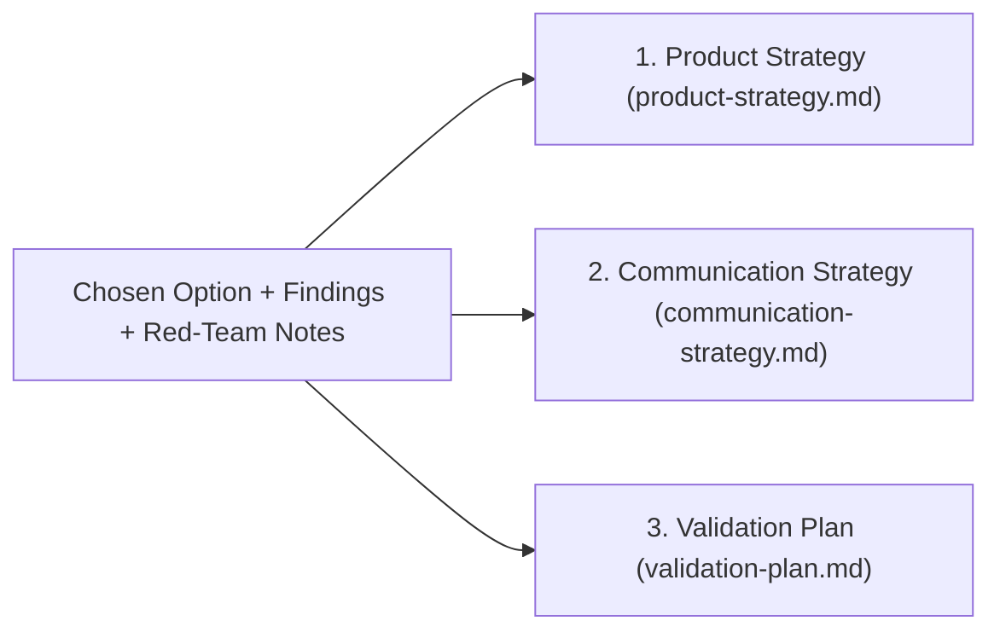

# Skill: Strategy Writer

## Overview
The `strategy-writer` skill transforms the chosen strategic option, verified evidence findings, and red-team mitigations into three publication-grade strategic deliverables.

---

## Operational Workflow

---

## Deliverables Specifications

### 1. Product Strategy
- **Path**: `knowledge/projects/<project>/output/product-strategy.md`
- **Core Pillars**:
  - Target audience & JTBD (Functional, Emotional, Social).
  - Existing alternatives & friction points.
  - Chosen vector & Conscious Refusals (What we will NOT do).
  - Value-to-Cost Economic Bridge (Unit economics: CAC, ARPA, LTV, Gross Margin).

### 2. Communication Strategy
- **Path**: `knowledge/projects/<project>/output/communication-strategy.md`
- **Core Components**:
  - Audience & purchase situations (Trigger moments).
  - Perception barriers & psychological friction.
  - Key Message & Reason to Believe (RTB) in Russian (`sasha` standard).
  - Omnichannel channel role matrix.
  - Promotional invariant: promises strictly match real product reality.

### 3. Strategic Validation Plan
- **Path**: `knowledge/projects/<project>/output/validation-plan.md`
- **Core Components**:
  - Falsifiable hypotheses [HYPOTHESIS].
  - Comparison baseline & observation window.
  - Guardrail metrics & cannibalization monitor.
  - Managerial decision rules (Scale vs Iterate vs Abort).

