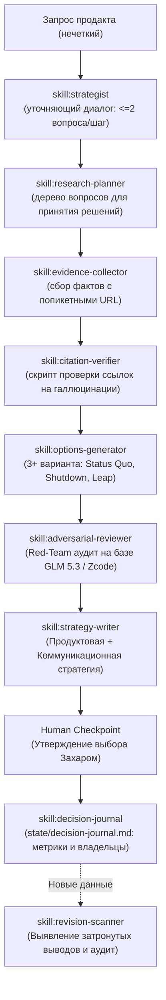

# Product Strategist Agent (MGIMO AI Challenge 2026)

[](https://ai-challenge.mgimo.ru)
[]()
[-orange)]()
[]()

Репозиторный ИИ-агент для лидеров цифровых продуктов. Проводит сквозную аналитику от нечеткого верхнеуровневого запроса до обоснованной продуктовой и коммуникационной стратегии, плана валидации и долгосрочного сопровождения решений.

---

## 1. Архитектурная парадигма: Repo-Agent

> **Ключевое отличие**: Это НЕ автономный демон с бэкграунд-процессами (никаких тяжелых фреймворков вроде LangGraph, CrewAI или AutoGen).  
> **Агент — это сам репозиторий.**  
> Вся работа происходит внутри современных агентских сред разработки (**AntiGravity IDE**, **Cursor**, **Claude Code**, **Zcode**), ведомая четкими правилами (`.agents/rules/`), специализированными навыками (`.agents/skills/`), валидированной методологией (`knowledge/methodology/`) и детерминированными файлами состояния (`state/`).



---

## 2. Быстрый старт за 5 минут (Quickstart)

### Требования
- Python 3.11+ (используется строго стандартная библиотека; сторонние зависимости не требуются).
- Любая среда разработки с поддержкой агентов: AntiGravity IDE, Cursor, Claude Code или Zcode.

### Шаг 1. Клонирование и настройка окружения
```bash
git clone https://github.com/Nek1yZakhar/product-strategist-agent.git
cd product-strategist-agent
cp .env.example .env
```
*(Отредактируйте `.env` при необходимости использования прямых API-ключей Gemini, GLM или Perplexity).*

### Шаг 2. Запуск локальных CLI-инструментов
Репозиторий укомплектован детерминированными утилитами:
```bash
# 1. Извлечение и нормализация брифа из PDF или текста
python scripts/extract_brief.py Primer-brifa.pdf --project demo-megafon

# 2. Проверка достоверности ссылок и защита от галлюцинаций URL (arXiv:2504.00317)
python scripts/verify_citations.py --project demo-megafon --update

# 3. Формирование прозрачного финансового отчета по токенам и затратам
python scripts/cost_summary.py

# 4. Валидация DAG-зависимостей и локальный запуск мульти-агентных тикетов (Team Work)
python scripts/teamwork_runner.py --validate-all
```

### Шаг 3. Запуск агента в IDE
Откройте корневую папку проекта в **AntiGravity IDE** или **Cursor**. В окне чата агента напишите:
> `Изучи AGENTS.md и state/STATE-current-task.md. Возобнови стратегическую сессию по брифу МегаФона.`

---

## 3. Матрица моделей и распределение ролей

| Роль в системе | Движок / Модель | Среда исполнения | Обоснование выбора |
| :--- | :--- | :--- | :--- |
| **Основной стратег** | `Gemini 3.8 Flash` | AntiGravity IDE | Минимальная задержка, контекст до 1M токенов, нативная поддержка инструментов, себестоимость ~$0.10/1M токенов. |
| **Adversarial Red-Team** | `GLM 5.3` | Zcode IDE / Direct API | Независимая когнитивная модель, беспощадный аудит юнит-экономики и скрытых издержек, исключение когнитивного эха. |
| **Панель триангуляции** | `Perplexity Pro` *(Sonnet 5.5, GPT-6.2)* | Внешний веб-поиск | Перекрестная проверка отраслевых данных и нормативных актов операторов РФ. |

---

## 4. Научная честность и антигаллюцинационные стандарты

В основу агента заложены современные академические исследования надежности языковых моделей:
1. **Защита от вымышленных ссылок (3–13% галлюцинаций URL)**: Согласно [arXiv:2504.00317](https://arxiv.org/abs/2504.00317), до 13% ссылок в отчетах автономных ресерчеров вымышлены. Наш `scripts/verify_citations.py` валидирует каждый URL через HTTP 200 перед включением факта в стратегию.
2. **Предотвращение каскадных ошибок оркестратора**: [arXiv:2608.24306](https://arxiv.org/abs/2608.24306) доказывает, что 84.7% ошибок финальных отчетов зарождаются на этапе сбора данных. Мы изолируем каждый факт в отдельный файл с YAML-метаданными.
3. **Честность синтетических респондентов**: Исследования [Chen, Zhu, & Zheng (arXiv:2507.04438)](https://arxiv.org/abs/2507.04438) и валидация Verasight 2026 (RMSE 8.3 п.п.) доказали: **LLM-персоны не способны достоверно моделировать потребительский спрос и готовность платить**. Мы строго запрещаем использовать синтетических респондентов как доказательство спроса; они применяются исключительно для генерации качественных гипотез с обязательным дисклеймером.

---

## 5. Эталонный демонстрационный кейс («МегаФон Семья»)

В папке `knowledge/projects/demo-megafon/` сформирован полный сквозной кейс, синхронизированный с 11-страничным конкурсным первоисточником `Пример брифа.pdf`:
- `brief.md` & `data/baseline-metrics.md`: Каноническая таблица базовых метрик (базовый год 275 млн ₽ оценка / 282 млн ₽ план, плановый год 279 млн ₽ без изменений / 285 млн ₽ цель, дельта +6 млн ₽ = 12 000 доп. месяцев по 500 ₽, 100K домохозяйств, 40K мульти-SIM, лимит 3 чел.-мес. разработки на Q2).
- `findings/`: 5 верифицированных фактологических файлов с подтвержденными ссылками (100% verified, arXiv:2504.00317).
- `output/options.md`: 4-вариантная матрица (Вариант А: «Упреждающий сигнал / Lightweight Core», Вариант B: «Полномасштабный семейный хаб», Вариант C: «Status Quo», Вариант D: «Shutdown») со строгими steelman-контраргументами.
- `output/adversarial-review.md`: Жесткая рецензия Red-Team GLM 5.3 с нейтрализацией рисков спама пушами (троттлинг 1 пуш на событие) и защитой приватности (152-ФЗ).
- `output/product-strategy.md`: 5-секционная продуктовая стратегия по структуре брифа (разбор перебоя связи за 45 мин., роли Организатора/Участника/Плательщика, упреждающий push, снижение блокировок с 12% до 9%, окупаемость за 5.5 месяцев, 3-летний горизонт — 24 000 групп).
- `output/communication-strategy.md`: Коммуникационная стратегия с ключевым сообщением по стандарту `sasha` без скрытых звездочек.
- `output/validation-plan.md`: Контролируемый A/B пилот в Q2 на 2 000 групп со стратификацией и жесткими критериями Kill Switch (утечки согласий, двойные списания).
- `output/ux-journey.md`: Анализ интерфейсов и устранение барьера потери 42% конверсии через изолированные согласия.
- `state/decision-journal.md`: Запись решения `DEC-2026-MF-01` с фиксацией Захара как владельца.

---

## 6. Структура репозитория

```text
product-strategist-agent/
├── AGENTS.md                      # Lean Domain Passport (30 строк)
├── README.md                      # Полное руководство первого запуска
├── .env.example                   # Шаблон переменных окружения
├── .agents/
│   ├── rules/                     # 6 ключевых правил (workflow, evidence, knowledge, cost, research, deliverables)
│   └── skills/                    # 11 специализированных навыков (SKILL.md)
├── knowledge/
│   ├── methodology/               # Стандарты доказательств, шаблоны стратегий, red-team промпты
│   └── projects/demo-megafon/     # Демо-проект «МегаФон Семья» (бриф, данные, находки, стратегии)
├── state/                         # STATE-current-task.md, decision-journal.md, cost-log.csv
├── scripts/                       # verify_citations.py, extract_brief.py, cost_summary.py, teamwork_runner.py, generate_submission_pdf.py
├── docs/                          # ARCHITECTURE.md, STATE.md, CONTEXT.md, SUBMISSION.md, specs/ (11 тикетов), specs/TRACEABILITY.md, source/
└── demo/                          # RUNBOOK.md, VIDEO-PLAN.md, session_transcript.jsonl
```

---

## 7. Автор и участие в конкурсе

- **Автор проекта**: **Захар (Zakhar, Solo Maker)**.
- Проект разработан в рамках конкурса **MGIMO AI Challenge 2026** (трек «Стратег Фабрики продуктов МегаФона»).
- Сдача проекта: ноябрь 2026 г.

