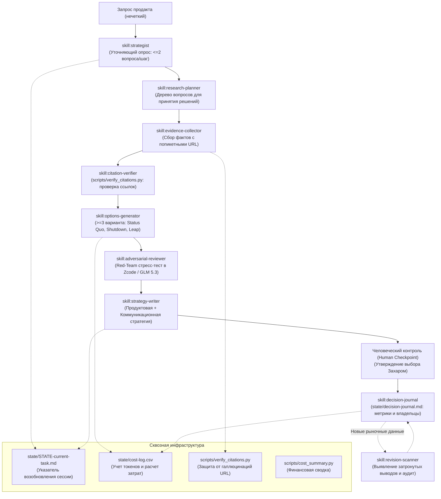

# Архитектура системы: Product Strategist Agent

**Product Strategist Agent** — репозиторный ИИ-агент (Repo-Agent) для конкурса MGIMO AI Challenge 2026 (номинация «ИИ-проект», трек «Стратег Фабрики продуктов МегаФона»). Агент функционирует непосредственно внутри сред разработки с поддержкой ИИ (**AntiGravity IDE**, **Cursor**, **Claude Code**, **Zcode**) через систему декларативных правил, специализированных навыков (skills) и детерминированных файлов состояния, без использования тяжелых внешних фреймворков и демонов.

---

## 1. Сквозной поток данных и компонентов



---

## 2. Матрица моделей и Pro-подписок

В проекте используется экономичная архитектура, опирающаяся на **активные Pro-подписки в специализированных средах разработки** вместо дорогостоящего прямого биллинга API:

| Роль в архитектуре | Модель / Движок | Среда / Формат доступа | Обоснование выбора и экономика |
| :--- | :--- | :--- | :--- |
| **Основной стратег и оркестратор** | `Gemini 3.8 Flash` | **AntiGravity IDE** (Pro-сессия) | Сверхнизкая задержка, контекст до 1M токенов, нативная поддержка инструментов в IDE. Нулевой попикетный биллинг в рамках подписки. |
| **Adversarial Red-Team критик** | `GLM 5.3` | **Zcode IDE** (Coding Plan / Pro) | Альтернативное когнитивное семейство моделей, жесткая критика юнит-экономики и скрытых рисков, исключение когнитивного эха. |
| **Панель внешней триангуляции** | `Perplexity Pro` *(Sonnet 5.5, GPT-6.2)* | Веб-интерфейс / Copilot | Перекрестная проверка открытых данных по рынку РФ, тарифам операторов и нормативным документам. |
| **Локальные CLI-скрипты** | Python 3.11+ Stdlib / Google AI Studio | Терминал / Бесплатный Free-Tier ключ | Детерминированная проверка ссылок (`verify_citations.py`) и агрегация затрат (`cost_summary.py`). Бесплатный ключ AI Studio без привязки карт. |

---

## 3. Принцип 4-слойной изоляции репозитория

```text
product-strategist-agent/
├── AGENTS.md                  # Слой 1: Паспорт домена (неизменяемые инварианты)
├── .agents/
│   ├── rules/                 # Слой 1: Поведенческие правила и ограничения
│   └── skills/                # Слой 1: 11 модульных операционных навыков (SKILL.md)
├── knowledge/
│   ├── methodology/           # Слой 2: Проверенные стратегические фреймворки и стандарты
│   └── projects/              # Слой 3: Материалы проекта, брифы, верифицированные факты
├── state/                     # Слой 4: Файлы состояния сессии, журнал решений, лог затрат
├── scripts/                   # Детерминированные утилиты на чистом Python
└── docs/                      # Архитектура, контекст, спецификации тикетов, первоисточники
```

---

## 4. Журнал архитектурных решений (ADR)

### ADR-001: Репозиторный агент (Repo-Agent) вместо автономного демона
- **Контекст**: Требование конкурса — создать инструмент для лидера продукта, встраиваемый в рабочий процесс.
- **Решение**: Отказ от тяжелых фреймворков (LangGraph, CrewAI). Агент воплощен в структуре папок, правилах и навыках внутри IDE.
- **Последствия**: Полная воспроизводимость, нулевые накладные расходы на инфраструктуру, переносимость между IDE.

### ADR-002: Детерминированная проверка ссылок против галлюцинаций
- **Контекст**: Исследования фиксируют 3–13% вымышленных URL в отчетах ИИ (arXiv:2504.00317).
- **Решение**: Обязательный запуск `scripts/verify_citations.py` с проверкой каждого источника по протоколу HTTP HEAD/GET.
- **Последствия**: Исключение ложных фактов из основы стратегий; 100% подтвержденный Ground Truth.

### ADR-003: Честность синтетических респондентов
- **Контекст**: LLM-персоны не способны достоверно моделировать потребительский спрос (arXiv:2607.26348, Verasight 2026).
- **Решение**: Синтетические респонденты используются строго для качественной генерации гипотез с обязательным дисклеймером.
- **Последствия**: Соответствие этическим и научным стандартам конкурса, защита от ложноположительных сигналов рынка.

### ADR-004: Двухконтурный Red-Team на базе Zcode / GLM 5.3
- **Контекст**: Одной модели свойственно оправдывать собственные предположения.
- **Решение**: Рецензирование вариантов стратегии вынесено на независимую модель GLM 5.3 в Zcode IDE.
- **Последствия**: Независимый аудит юнит-экономики, выявление рисков каннибализации и маржинальных утечек.
