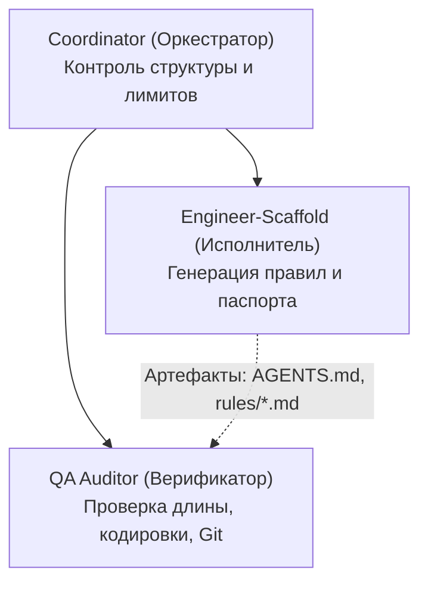

# TICKET-01: Базовый каркас репозитория, паспорт управления и аудит здоровья

## 1. Контекст, проблема и инварианты (Context, Problem & Invariants)

### 1.1. Контекст и бизнес-проблема
Агентные среды разработки (**AntiGravity IDE**, **Cursor**, **Claude Code**, **Zcode**) требуют строгой топологии репозитория. В отсутствие явного компактного паспорта домена и модульных правил мульти-агентные команды (Team Work) сталкиваются с потерей контекста, галлюцинациями файловых границ, циклическими сканированиями дерева каталогов и попытками запуска тяжелых фоновых демонов, блокирующих работу IDE.

### 1.2. Архитектурные инварианты
- **Solo-Maker Invariant**: Проект создается исключительно Захаром (`Захар`) как единственным автором; исключен любой корпоративный театр и фиктивные роли.
- **Zero-Mock Policy**: В базовом каркасе запрещены заглушки или фейковые окружения; все пути и ссылки на правила детерминированы.
- **No-Truncation Policy**: Манифест и правила создаются полностью без плейсхолдеров (`// ...`, `TODO`).
- **Context Budget Ceiling**: Паспорт домена `AGENTS.md` строго ограничен 25–40 строками во избежание перегрузки системного промпта.

---

## 2. Архитектура и топология Team Work (Team Work Topology & Roles)

### 2.1. Ролевая матрица субагентов
Для автономного исполнения каркаса задействуется 3-ролевая топология Team Work:



| Роль агента | Тип субагента | Зона ответственности | Входные данные | Выходные артефакты | Шаговый бюджет |
| :--- | :--- | :--- | :--- | :--- | :---: |
| **Coordinator** | `strategist` / `self` | Планирование задач, валидация структуры папок, регистрация тикета. | `docs/STATE.md` | `docs/STATE.md`, `state/STATE-current-task.md` | $\le 5$ шагов |
| **Engineer-Scaffold** | `coder` / `self` | Создание `.agents/rules/*.md`, `AGENTS.md`, `.gitignore`, `.env.example`. | Конкурсное ТЗ, правила AGY | `AGENTS.md`, `.agents/rules/*.md`, `.gitignore` | $\le 10$ шагов |
| **QA Auditor** | `verifier` / `self` | Валидация объема строк (25–40), кодировки UTF-8, Git-статуса `.env`. | Созданные файлы | Лог верификации в консоли | $\le 5$ шагов |

### 2.2. Изоляция файловых границ (File Boundary Isolation)
- **Зона записи Engineer-Scaffold**: `AGENTS.md`, `.gitignore`, `.env.example`, `.agents/rules/*.md`.
- **Зона чтения QA Auditor**: Весь репозиторий (Read-Only). Запись строго запрещена.
- **Защищенная зона**: Папка `docs/source/` — иммутабельна (Read-Only для всех ролей).

### 2.3. Директива запуска субагентов (Invoke Subagent Directive)
```text
Execute deep focused scaffolding without repetitive scans or spinning.
Actively monitor context headroom: AGENTS.md must strictly contain between 25 and 40 lines.
Ensure all 6 rules in .agents/rules/ are created with complete specifications.
Conclude cleanly and report findings once the core structure is verified.
```

---

## 3. Детерминированные контракты реализации (Implementation Contracts)

### 3.1. Структура манифеста домена `AGENTS.md`
- Заголовок и краткое назначение репозитория (MGIMO AI Challenge 2026, трек «Стратег Фабрики продуктов МегаФона»).
- Таблица матрицы моделей и подписок (AntiGravity IDE Pro, Zcode IDE Coding Plan, Perplexity Pro).
- Список CLI-скриптов (`scripts/verify_citations.py`, `scripts/cost_summary.py`, `scripts/extract_brief.py`, `scripts/teamwork_runner.py`).
- Описание переменных окружения (`.env.example`).
- Указатели на активное состояние (`state/STATE-current-task.md`, `docs/STATE.md`).
- Лимит объема: от 25 до 40 строк.

### 3.2. Матрица правил `.agents/rules/` (6 правил)
1. `workflow.md`: 6-фазный воркфлоу, чекпоинты с человеком, переходы состояний.
2. `evidence.md`: Стандарты доказательств, попикетные URL, запрет галлюцинаций (arXiv:2504.00317).
3. `knowledge.md`: 4-слойная изоляция репозитория (architecture, methodology, projects, state).
4. `cost.md`: Дисциплина учета токенов, логирование в `cost-log.csv`, нулевой попикетный биллинг через Pro-сессии.
5. `research.md`: Формулировка гипотез, отказ от тщеславных исследований, лимит вопросов $\le 2$/шаг.
6. `deliverables.md`: Структура артефактов (Product Strategy, Communication Strategy, Validation Plan).

---

## 4. Криминалистический чеклист приемки (Forensic Acceptance Checklist)

### 4.1. Автоматизированные тесты
```powershell
# 1. Проверка наличия и объема паспорта AGENTS.md (25-40 строк)
$lines = (Get-Content AGENTS.md | Measure-Object -Line).Lines
if ($lines -ge 25 -and $lines -le 40) { Write-Host "AGENTS.md line count OK: $lines" } else { throw "AGENTS.md out of range: $lines" }

# 2. Проверка наличия всех 6 правил
$rules = Get-ChildItem -Path ".agents\rules" -Filter "*.md"
if ($rules.Count -eq 6) { Write-Host "Rules count OK: $($rules.Count)" } else { throw "Expected 6 rules, found $($rules.Count)" }

# 3. Проверка игнорирования .env
git check-ignore .env
```

### 4.2. Критерии готовности ("Done When")
- [x] Файл `AGENTS.md` существует, валиден и содержит ровно 25–40 строк.
- [x] В папке `.agents/rules/` присутствуют ровно 6 правил в формате Markdown.
- [x] Файл `.env.example` не содержит реальных секретов.
- [x] Команда `git status` подтверждает игнорирование `.env`.
- [x] Тест `python scripts/teamwork_runner.py --ticket TICKET-01 --mode live` возвращает статус `[SUCCESS]`.
