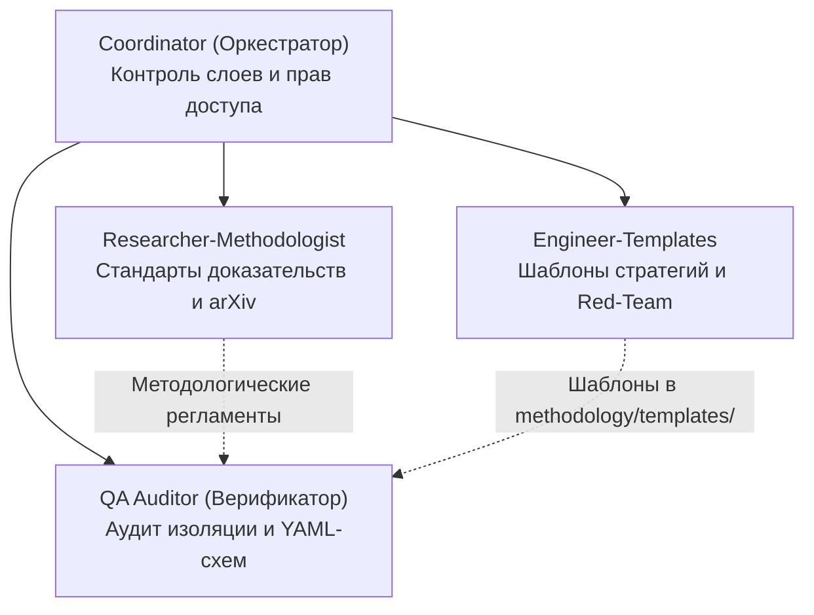

# TICKET-02: 4-слойная изоляция знаний и стандарты методологии

## 1. Контекст, проблема и инварианты (Context, Problem & Invariants)

### 1.1. Контекст и бизнес-проблема
В мульти-агентных аналитических системах возникает риск взаимного загрязнения памяти: субагенты могут перезаписывать общую методологию данными текущего проекта либо применять специфические предположения одного клиента ко всей системе. Для обеспечения научной строгости и воспроизводимости стратегий необходима строгая 4-слойная изоляция файлового пространства репозитория:
1. **Слой 1 (Система & Правила)**: `AGENTS.md`, `.agents/rules/`, `.agents/skills/`.
2. **Слой 2 (Методология & Стандарты)**: `knowledge/methodology/` (фреймворки, стандарты доказательств, шаблоны).
3. **Слой 3 (Экземпляры проектов & Факты)**: `knowledge/projects/<project>/` (брифы, findings, options, стратегии).
4. **Слой 4 (Состояние исполнения & Логи)**: `state/` (возобновление сессии, журнал решений, учет токенов).

### 1.2. Архитектурные инварианты
- **Ground Truth Invariant**: Папка `docs/source/` содержит эталонные брифы и задание конкурса (`task_ru.md`, `demo_brief_ru.md`) — запись в нее строго запрещена (Read-Only).
- **Epistemic Classification Invariant**: Любое утверждение в слое 3 обязано иметь строгую эпистемическую маркировку (`[FACT]`, `[HYPOTHESIS]`, `[ASSUMPTION]`) с верифицированным URL-источником.
- **Synthetic Honesty Invariant**: Синтетические респонденты запрещены для оценки платежеспособного спроса и WTP (arXiv:2507.04438).
- **Zero-Mock Policy**: Все шаблоны методологии должны содержать реальные рабочие разделы и формулы без пустых заглушек.

---

## 2. Архитектура и топология Team Work (Team Work Topology & Roles)

### 2.1. Ролевая матрица субагентов



| Роль агента | Тип субагента | Зона ответственности | Входные данные | Выходные артефакты | Шаговый бюджет |
| :--- | :--- | :--- | :--- | :--- | :---: |
| **Coordinator** | `strategist` / `self` | Валидация 4-слойной структуры папок, маршрутизация задач. | `docs/ARCHITECTURE.md` | `docs/STATE.md` | $\le 5$ шагов |
| **Researcher-Methodologist** | `researcher` / `self` | Формирование `evidence-standards.md`, `strategy-frameworks.md`, `synthetic-respondents.md`. | Научные публикации (arXiv:2504.00317, arXiv:2507.04438) | `knowledge/methodology/*.md` | $\le 10$ шагов |
| **Engineer-Templates** | `coder` / `self` | Создание эталонных шаблонов в `knowledge/methodology/templates/` и `red-team/`. | Фреймворки стратегий | `templates/*.md`, `red-team-prompt.md` | $\le 8$ шагов |
| **QA Auditor** | `verifier` / `self` | Проверка отсутствия проектных данных в слое 2 и валидность YAML. | Сгенерированные файлы | Отчет о целостности слоев | $\le 5$ шагов |

### 2.2. Изоляция файловых границ (File Boundary Isolation)
- **Зона записи Researcher-Methodologist**: `knowledge/methodology/*.md`.
- **Зона записи Engineer-Templates**: `knowledge/methodology/templates/`, `knowledge/methodology/red-team/`.
- **Защищенная зона**: `knowledge/projects/` не должна затрагиваться при выполнении этого тикета.

### 2.3. Директива запуска субагентов (Invoke Subagent Directive)
```text
Execute rigorous methodology authoring and knowledge layer separation.
Ensure evidence standards incorporate arXiv:2504.00317 (URL hallucinations) and arXiv:2507.04438 (synthetic bias).
Strictly isolate methodology templates from project-specific telecom data.
Conclude cleanly once all methodology documents and templates are verified.
```

---

## 3. Детерминированные контракты реализации (Implementation Contracts)

### 3.1. Спецификация `knowledge/methodology/evidence-standards.md`
- Эпистемическая шкала:
  - `[FACT]`: Подтверждено официальным источником, протоколом испытаний или HTTP 200 ссылкой.
  - `[HYPOTHESIS]`: Логическое предположение, требующее проверки сплит-тестом или глубинным интервью.
  - `[ASSUMPTION]`: Входное допущение для финансовой модели с указанием диапазона чувствительности.
- YAML frontmatter контракт:
  ```yaml
  ---
  claim: "Формулировка проверенного факта"
  source_url: "https://..."
  verified: "verified | dead | hallucinated"
  confidence: "fact | hypothesis | assumption"
  date_checked: "YYYY-MM-DD"
  author: "Организация / автор исследования"
  data_period: "Год / квартал данных"
  ---
  ```

### 3.2. Спецификация шаблонов в `knowledge/methodology/templates/`
- `product-strategy.md`: Executive Summary, JTBD & сегменты, Value Proposition, Стратегические развилки, Юнит-экономика ($+500$ ₽ LTV), Осознанные отказы.
- `communication-strategy.md`: Ключевое сообщение по `sasha`, Барьеры восприятия, Матрица каналов, Инвариант честности обещаний.
- `validation-plan.md`: Гипотезы риска, Метрики пилота, Критерии отката и масштабирования.

---

## 4. Криминалистический чеклист приемки (Forensic Acceptance Checklist)

### 4.1. Автоматизированные тесты
```powershell
# 1. Проверка существования файлов методологии
$files = @(
    "knowledge/methodology/evidence-standards.md",
    "knowledge/methodology/strategy-frameworks.md",
    "knowledge/methodology/synthetic-respondents.md"
)
foreach ($f in $files) {
    if (-not (Test-Path $f)) { throw "Missing methodology file: $f" }
}

# 2. Проверка наличия научных ссылок в стандартах доказательств
$evText = Get-Content "knowledge/methodology/evidence-standards.md" -Raw
assert ($evText.Contains("arXiv:2504.00317")) "Missing arXiv:2504.00317 reference"
assert ($evText.Contains("arXiv:2507.04438")) "Missing arXiv:2507.04438 reference"

# 3. Тест раннера Team Work
python scripts/teamwork_runner.py --ticket TICKET-02 --mode live
```

### 4.2. Критерии готовности ("Done When")
- [x] Все ключевые файлы методологии и шаблоны созданы в `knowledge/methodology/`.
- [x] Стандарты доказательств содержат обязательную схему YAML frontmatter.
- [x] Синтетические персоны регламентированы запретом на подмену живых опросов.
- [x] Тест раннера `teamwork_runner.py` для TICKET-02 завершается с кодом 0.
