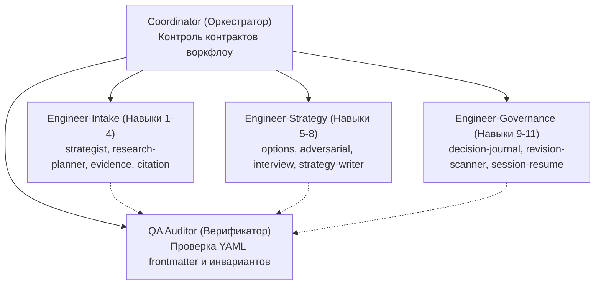

# TICKET-03: 6-фазный стратегический воркфлоу и движок навыков

## 1. Контекст, проблема и инварианты (Context, Problem & Invariants)

### 1.1. Контекст и бизнес-проблема
Неструктурированные монолитные промпты приводят к поверхностным шаблонным рекомендациям («галлюцинациям общего характера»), пропускают контрольные точки с лидером продукта и не способны предложить негативные развилки (например, закрытие направления). Для дисциплины мышления продакта требуется модульный движок навыков (Skills Engine), нативно поддерживаемый агентскими IDE по спецификации Anthropic / AgentSkills.io.

### 1.2. Архитектурные инварианты
- **Clarification Budget Invariant**: Навык `strategist` обязан задавать **не более 1–2 точечных вопросов** за диалоговый шаг, только если ответ блокирует следующий этап.
- **Mandatory Triad Invariant**: Навык `options-generator` обязан всегда формировать минимум 3 варианта: `Status Quo`, `Shutdown`, `Value Pivot/Leap` с сильными контраргументами к каждому.
- **Russian UI / Sasha Invariant**: Все сообщения, обращенные к человеку (лидеру продукта Захару), оформляются на живом русском языке по стандарту `sasha`.
- **English Code / Reasoning Invariant**: Внутренние промпты, схемы и системная логика навыков поддерживаются строго на английском языке для максимальной плотности рассуждений.

---

## 2. Архитектура и топология Team Work (Team Work Topology & Roles)

### 2.1. Ролевая матрица субагентов
Создание 11 навыков распараллеливается между тремя инженерами по функциональным группам:



| Роль агента | Тип субагента | Зона ответственности | Входные данные | Выходные артефакты | Шаговый бюджет |
| :--- | :--- | :--- | :--- | :--- | :---: |
| **Coordinator** | `strategist` / `self` | Контроль фазовой машины 1–6, назначение задач воркерам. | `.agents/rules/workflow.md` | `docs/STATE.md` | $\le 5$ шагов |
| **Engineer-Intake** | `coder` / `self` | Разработка навыков `strategist`, `research-planner`, `evidence-collector`, `citation-verifier`. | `knowledge/methodology/` | 4 файла `SKILL.md` | $\le 10$ шагов |
| **Engineer-Strategy** | `coder` / `self` | Разработка навыков `options-generator`, `adversarial-reviewer`, `interview-panel`, `strategy-writer`. | `knowledge/methodology/templates/` | 4 файла `SKILL.md` | $\le 10$ шагов |
| **Engineer-Governance** | `coder` / `self` | Разработка навыков `decision-journal`, `revision-scanner`, `session-resume`. | `state/`, спецификации возобновления | 3 файла `SKILL.md` | $\le 10$ шагов |
| **QA Auditor** | `verifier` / `self` | Проверка наличия всех 11 навыков, валидность YAML frontmatter, отсутствие плейсхолдеров. | `.agents/skills/*/SKILL.md` | Аудит-отчет навыков | $\le 5$ шагов |

### 2.2. Изоляция файловых границ (File Boundary Isolation)
- **Engineer-Intake**: Запись строго в `.agents/skills/{strategist,research-planner,evidence-collector,citation-verifier}/SKILL.md`.
- **Engineer-Strategy**: Запись строго в `.agents/skills/{options-generator,adversarial-reviewer,interview-panel,strategy-writer}/SKILL.md`.
- **Engineer-Governance**: Запись строго в `.agents/skills/{decision-journal,revision-scanner,session-resume}/SKILL.md`.
- Коллизии исключены благодаря непересекающимся целевым директориям.

### 2.3. Директива запуска субагентов (Invoke Subagent Directive)
```text
Execute deep skills development adhering to Anthropic AgentSkills.io standards.
Each SKILL.md must have valid YAML frontmatter (name, description) and complete operational instructions.
Enforce strict budget invariants: strategist asks <=2 questions/step; options-generator includes Status Quo, Shutdown, Leap.
Conclude cleanly once all allocated skills are verified without placeholders.
```

---

## 3. Детерминированные контракты реализации (Implementation Contracts)

### 3.1. Реестр 11 навыков в `.agents/skills/`
1. `strategist`: Главный оркестратор и цикл первичного уточнения (бюджет $\le 2$ вопросов).
2. `research-planner`: Декомпозиция цели в дерево вопросов для принятия решений (Heilmeier Catechism).
3. `evidence-collector`: Сбор и оформление фактологических находок с YAML frontmatter.
4. `citation-verifier`: Запуск детерминированного скрипта `scripts/verify_citations.py`.
5. `options-generator`: Обязательная генерация вариантов: Status Quo, Shutdown, Value Pivot.
6. `adversarial-reviewer`: Формирование Red-Team промптов для Zcode / GLM 5.3.
7. `interview-panel`: Симуляция качественных персон с обязательным дисклеймером (arXiv:2507.04438).
8. `strategy-writer`: Синтез Продуктовой, Коммуникационной стратегий и Плана валидации.
9. `decision-journal`: Протоколирование управленческих решений в `state/decision-journal.md`.
10. `revision-scanner`: Сканирование рыночных сдвигов и выявление затронутых выводов.
11. `session-resume`: Мгновенное восстановление рабочего контекста в чистом окне чата.

### 3.2. Стандарт заголовка YAML Frontmatter
```yaml
---
name: skill-name
description: Clear, action-oriented description of the skill and when it should be triggered.
---
```

---

## 4. Криминалистический чеклист приемки (Forensic Acceptance Checklist)

### 4.1. Автоматизированные тесты
```powershell
# 1. Проверка наличия ровно 11 файлов SKILL.md
$skills = Get-ChildItem -Path ".agents\skills" -Filter "SKILL.md" -Recurse
if ($skills.Count -eq 11) { Write-Host "Skills count OK: $($skills.Count)" } else { throw "Expected 11 skills, found $($skills.Count)" }

# 2. Проверка валидности YAML frontmatter во всех навыках
foreach ($s in $skills) {
    $content = Get-Content $s.FullName -Raw
    if (-not ($content -match "(?s)^---\s*\r?\nname:\s*.+?\r?\ndescription:\s*.+?\r?\n---")) {
        throw "Invalid YAML frontmatter in $($s.FullName)"
    }
}

# 3. Тест раннера Team Work
python scripts/teamwork_runner.py --ticket TICKET-03 --mode live
```

### 4.2. Критерии готовности ("Done When")
- [x] Ровно 11 папок созданы в `.agents/skills/`, каждая содержит валидный `SKILL.md`.
- [x] Каждый `SKILL.md` содержит непустые поля `name` и `description`.
- [x] Навык `strategist` содержит ограничение $\le 2$ вопросов за шаг.
- [x] Навык `options-generator` фиксирует обязательное наличие опций Status Quo и Shutdown.
- [x] Тест раннера `teamwork_runner.py` для TICKET-03 завершается с кодом 0.
