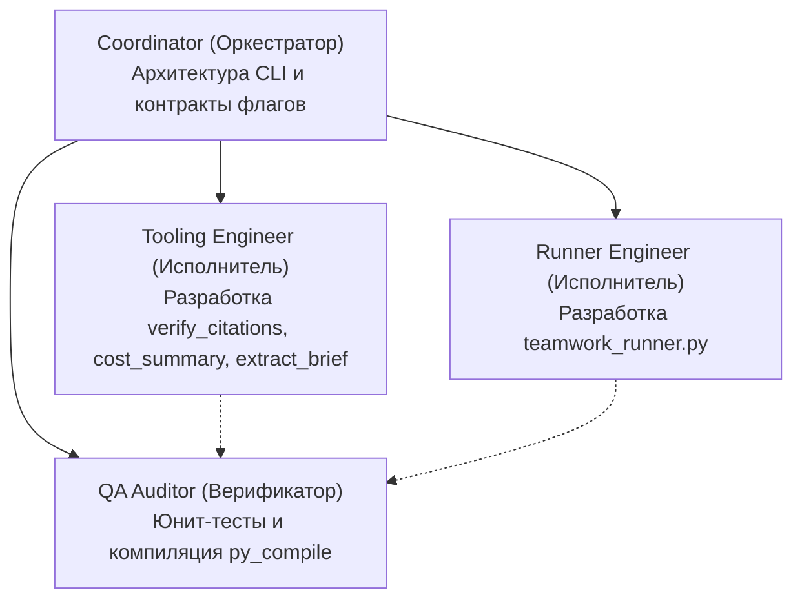

# TICKET-04: Детерминированные Python CLI утилиты и локальный инструментарий

## 1. Контекст, проблема и инварианты (Context, Problem & Invariants)

### 1.1. Контекст и бизнес-проблема
Агентные LLM-системы склонны к галлюцинациям в двух критических областях: вычислении числовых значений (NTN — No-Thinking-Numbers) и обращении к несуществующим веб-ссылкам (Phantom References, arXiv:2504.00317). Для исключения этих рисков все математические расчеты, аудит ссылок, экстракция брифов и координация мульти-агентных задач выносятся в **детерминированные Python CLI скрипты** на стандартной библиотеке Python 3.11+ без зависимости от платных API и внешних тяжелых платформ.

### 1.2. Архитектурные инварианты
- **NTN (No-Thinking-Numbers) Invariant**: Запрещено вычислять стоимость токенов или проверять доступность URL в контексте модели («в уме»). Все расчеты осуществляются кодом.
- **Pure Stdlib Priority (ADR-001)**: Утилиты функционируют на стандартной библиотеке Python (`urllib.request`, `asyncio`, `csv`, `json`, `argparse`), гарантируя работу на любой машине без компиляции тяжелых C-расширений.
- **Zero-Mock Policy**: Тесты скриптов выполняются против реальных протоколов (реальные HTTP HEAD/GET запросы, реальный парсинг `state/cost-log.csv`).
- **Encoding Hygiene Invariant**: Все операции чтения и записи файлов осуществляются строго с `encoding='utf-8'`.

---

## 2. Архитектура и топология Team Work (Team Work Topology & Roles)

### 2.1. Ролевая матрица субагентов



| Роль агента | Тип субагента | Зона ответственности | Входные данные | Выходные артефакты | Шаговый бюджет |
| :--- | :--- | :--- | :--- | :--- | :---: |
| **Coordinator** | `strategist` / `self` | Спецификация интерфейсов командной строки (argparse), кодов возврата. | Конкурсное ТЗ, `AGENTS.md` | `docs/specs/TICKET-04*.md` | $\le 5$ шагов |
| **Tooling Engineer** | `coder` / `self` | Разработка `verify_citations.py`, `extract_brief.py`, `cost_summary.py`. | Данные проекта, `cost-log.csv` | Файлы скриптов в `scripts/` | $\le 10$ шагов |
| **Runner Engineer** | `coder` / `self` | Разработка `scripts/teamwork_runner.py` для параллельного запуска задач. | Спецификации тикетов | `scripts/teamwork_runner.py` | $\le 8$ шагов |
| **QA Auditor** | `verifier` / `self` | Разработка тестов `tests/test_teamwork_runner.py`, запуск `py_compile`. | Все скрипты в `scripts/` | Зеленый прогон тестов | $\le 5$ шагов |

### 2.2. Изоляция файловых границ (File Boundary Isolation)
- **Tooling Engineer**: Запись строго в `scripts/{verify_citations.py,extract_brief.py,cost_summary.py}`.
- **Runner Engineer**: Запись строго в `scripts/teamwork_runner.py`.
- **QA Auditor**: Запись строго в `tests/test_teamwork_runner.py`.
- Ни один агент не перезаписывает скрипты другого воркера.

### 2.3. Директива запуска субагентов (Invoke Subagent Directive)
```text
Execute deep deterministic tooling implementation in Python 3.11+ stdlib.
Enforce NTN and pure standard library architecture without heavy external frameworks.
Ensure all CLI utilities support --help, exit code 0 on success, and non-zero on failure.
Conclude cleanly once py_compile and unit tests pass.
```

---

## 3. Детерминированные контракты реализации (Implementation Contracts)

### 3.1. Спецификация утилит в `scripts/`
1. `scripts/verify_citations.py`:
   - Аргументы: `--project <name>`, `--url <url>`, `--update`.
   - Логика: HTTP HEAD (с fallback на GET при коде 405), распознавание WAF (код 403 на живом домене как `verified (WAF Protected)`), выявление тестовых заглушек (`example.com`, `fake.org` $\to$ `hallucinated`).
   - Вывод: Таблица статусов с HTTP-кодами.
2. `scripts/extract_brief.py`:
   - Аргументы: `input_path`, `--project <name>`.
   - Логика: Извлечение текста из PDF (через `pypdf` при наличии или regex fallback) / Markdown, нормализация в каноническую структуру брифа `knowledge/projects/<project>/brief.md`.
3. `scripts/cost_summary.py`:
   - Аргументы: `--csv <path>`, `--json`.
   - Логика: Парсинг `state/cost-log.csv`, подсчет суммарных токенов (Prompt, Completion, Total), расчет стоимости по тарифам моделей в USD и RUB, учет бесплатного пула в рамках Pro-подписок.
4. `scripts/teamwork_runner.py`:
   - Аргументы: `--ticket <ID>`, `--mode {dry-run, live}`, `--validate-all`, `--dag`.
   - Логика: Асинхронная проверка DAG-зависимостей, валидация изоляции файлов и параллельный запуск верификаций.

---

## 4. Криминалистический чеклист приемки (Forensic Acceptance Checklist)

### 4.1. Автоматизированные тесты
```powershell
# 1. Синтаксическая компиляция всех скриптов
python -m py_compile scripts/verify_citations.py scripts/cost_summary.py scripts/extract_brief.py scripts/teamwork_runner.py

# 2. Проверка verify_citations на эталонных ссылках
python scripts/verify_citations.py --url https://habr.com
python scripts/verify_citations.py --url https://example.com/fake-link

# 3. Проверка cost_summary
python scripts/cost_summary.py

# 4. Проверка экстрактора брифа
python scripts/extract_brief.py docs/source/demo_brief_ru.md --project demo-megafon

# 5. Запуск юнит-тестов раннера
python -m unittest tests/test_teamwork_runner.py

# 6. Тест раннера Team Work для TICKET-04
python scripts/teamwork_runner.py --ticket TICKET-04 --mode live
```

### 4.2. Критерии готовности ("Done When")
- [x] Все 4 скрипта компилируются без ошибок синтаксиса на Python 3.11+.
- [x] Скрипт `verify_citations.py` возвращает `verified` для `habr.com` и `hallucinated` для `example.com`.
- [x] Скрипт `cost_summary.py` формирует сводку расходов в валютах USD и RUB.
- [x] Все юнит-тесты в `tests/test_teamwork_runner.py` завершаются со статусом `OK`.
