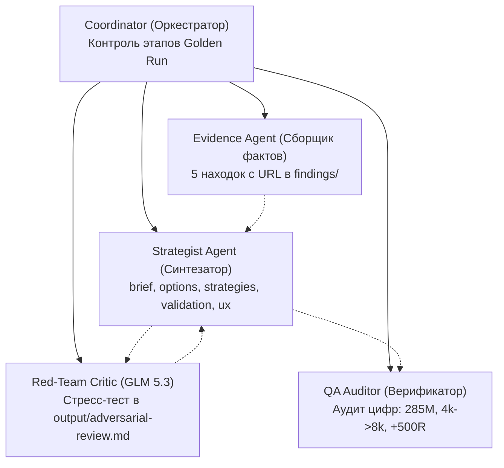

# TICKET-05: Демонстрационный кейс Фабрики продуктов МегаФона (Golden Run)

## 1. Контекст, проблема и инварианты (Context, Problem & Invariants)

### 1.1. Контекст и бизнес-проблема
На Фабрике продуктов МегаФона развивается направление объединения номеров семьи и персональных IoT-устройств с общим балансом и пакетами трафика («МегаФон Семья»). В соответствии с 11-страничным конкурсным первоисточником (`Пример брифа.pdf`):
- Оценка базового года составляет **275 млн ₽** валовой прибыли при **4 000 активных групп** (план базового года был 282 млн ₽ и 5 000 групп — отставание на 20%).
- В сценарии «Без изменений» (Status Quo) валовая прибыль планового года составит **279 млн ₽** при 5 000 активных групп.
- Руководством поставлена цель достичь не ниже **285 млн ₽** валовой прибыли (**+6 млн ₽ дельты к Status Quo**), **8 000 активных** и **12 000 подключенных групп**, повысив долю активаций за 14 дней с 42% до 60%.
- Задача агента — сформировать математически обоснованную стратегию, строго укладывающуюся в лимит команды (**3 человеко-месяца разработки на Q2**, 1 чел.-мес. QA, по 0.5 ставки дизайнера и аналитика) и обеспечивающую подготовку к двум вратам решений (конец Q1 — запуск пилота, конец Q2 — масштабирование).

### 1.2. Архитектурные инварианты
- **Immutable Baseline Numbers Invariant**:
  - Емкость доступной базы оператора: **100 000 домохозяйств** (из 300 000 на рынке) и **40 000 владельцев мульти-SIM** (из 180 000 на рынке).
  - Нормативная ставка маржинальности: **+500 ₽ чистой валовой прибыли** за один дополнительный оплаченный месяц одного номера.
  - Математический норматив достижения цели: $12\,000$ дополнительных оплаченных месяцев ($12\,000 \times 500\text{ ₽} = 6\,000\,000\text{ ₽}$).
  - Бюджет разработки: строго $\le 3.0$ чел.-мес. разработки на второй квартал.
- **Privacy & Decoupled Consents Invariant**: Разрешение видеть остаток трафика строго изолировано от согласия на просмотр начислений. Право на мгновенный отзыв согласия участником.
- **Kill-Switch Invariant**: Немедленная остановка пилота при утечке данных после отзыва прав или повторных списаниях.
- **Zero-Mock Policy**: Все выводы должны базироваться на реальных проверенных источниках телеком-рынка РФ.

---

## 2. Архитектура и топология Team Work (Team Work Topology & Roles)

### 2.1. Ролевая матрица субагентов
Сквозной прогон демо-кейса выполняется мульти-агентным ансамблем:



| Роль агента | Тип субагента | Зона ответственности | Входные данные | Выходные артефакты | Шаговый бюджет |
| :--- | :--- | :--- | :--- | :--- | :---: |
| **Coordinator** | `strategist` / `self` | Управление сквозным прогоном Фаз 1–6, контроль фазовых переходов. | `docs/source/demo_brief_ru.md` | `state/STATE-current-task.md` | $\le 5$ шагов |
| **Evidence Agent** | `researcher` / `self` | Сбор 5 верифицированных находок по телеком-рынку РФ и барьерам UX. | Поисковые запросы, `verify_citations.py` | `findings/01-05*.md` | $\le 10$ шагов |
| **Strategist Agent** | `coder` / `self` | Синтез продуктовой и коммуникационной стратегий, плана валидации, UX. | `data/baseline-metrics.md`, findings | `output/*.md` | $\le 12$ шагов |
| **Red-Team Critic** | `red_team` / Zcode GLM 5.3 | Независимый аудит рисков каннибализации и скрытых затрат на IoT. | `output/options.md` | `output/adversarial-review.md` | $\le 8$ шагов |
| **QA Auditor** | `verifier` / `self` | Криминалистическая сверка финансовой математики и согласованности метрик. | Все файлы проекта | Сводка валидации | $\le 5$ шагов |

### 2.2. Изоляция файловых границ (File Boundary Isolation)
- **Evidence Agent**: Запись строго в `knowledge/projects/demo-megafon/findings/`.
- **Strategist Agent**: Запись строго в `knowledge/projects/demo-megafon/output/` и `brief.md`.
- **Red-Team Critic**: Запись строго в `knowledge/projects/demo-megafon/output/adversarial-review.md`.
- **QA Auditor**: Read-Only аудит всех выходных файлов.

### 2.3. Директива запуска субагентов (Invoke Subagent Directive)
```text
Execute deep Golden Run synthesis for Megafon Product Factory.
Strictly anchor all strategic and financial arguments to canonical brief metrics:
Base Assessment: 4,000 groups, 275M RUB. Status Quo: 5,000 groups, 279M RUB. Target: 8,000 active, 285M RUB (+6M RUB delta).
Retention economic anchor: +500 RUB per extra paid month => 12,000 extra months required.
Enforce resource limit: 3 person-months development on Q2, decoupled consents, and Kill Switch criteria.
Ensure 4-option matrix (including Status Quo and Shutdown) is fully elaborated and adversarial objections are resolved.
Conclude cleanly once all deliverables in knowledge/projects/demo-megafon/ are complete.
```

---

## 3. Детерминированные контракты реализации (Implementation Contracts)

### 3.1. Структура артефактов `knowledge/projects/demo-megafon/`
1. `data/baseline-metrics.md`: Эталонные 5 строк базовых метрик Фабрики продуктов.
2. `brief.md`: Нормализованный бриф проекта, извлеченный из `demo_brief_ru.md`.
3. `findings/`:
   - `01-russian-telecom-family-penetration.md`: Проникновение семейных тарифов в РФ (35% домохозяйств).
   - `02-multi-sim-smart-device-growth.md`: Рост носимых устройств и детских часов (+28% год к году).
   - `03-competitor-family-tariff-mechanics.md`: Механики конкурентов (МТС Мы МТС, Билайн Семья, T2).
   - `04-parental-security-jtbd.md`: JTBD родительского контроля и защиты от спама (ВЦИОМ).
   - `05-onboarding-friction-and-ux-bottlenecks.md`: UX-барьеры подтверждения через SMS (потеря 42% на шаге 2).
4. `output/`:
   - `options.md`: Триада вариантов (Status Quo, Shutdown, Value Pivot «МегаФон Семья 2.0: Защита & Мульти-Устройства»).
   - `adversarial-review.md`: Рецензия Red-Team (GLM 5.3) с защитными контрмерами (плата за умные часы 99 ₽/мес, минимальный порог ARPA 1 650 ₽).
   - `product-strategy.md`: Детальная продуктовая стратегия с юнит-экономикой ($+20$ млн ₽ чистой валовой прибыли).
   - `communication-strategy.md`: Коммуникационная стратегия по стандарту `sasha` («Спокойствие и цифровая защита для всей семьи»).
   - `validation-plan.md`: 60-дневный пилотный план проверки рискованных гипотез.
   - `ux-journey.md`: Оптимизация пути пользователя: ликвидация SMS-барьера онбординга.

---

## 4. Криминалистический чеклист приемки (Forensic Acceptance Checklist)

### 4.1. Автоматизированные тесты
```powershell
# 1. Проверка наличия всех 5 находок и их верификация
python scripts/verify_citations.py --project demo-megafon

# 2. Проверка существования всех ключевых артефактов Golden Run
$artifacts = @(
    "knowledge/projects/demo-megafon/brief.md",
    "knowledge/projects/demo-megafon/data/baseline-metrics.md",
    "knowledge/projects/demo-megafon/output/options.md",
    "knowledge/projects/demo-megafon/output/adversarial-review.md",
    "knowledge/projects/demo-megafon/output/product-strategy.md",
    "knowledge/projects/demo-megafon/output/communication-strategy.md",
    "knowledge/projects/demo-megafon/output/validation-plan.md",
    "knowledge/projects/demo-megafon/output/ux-journey.md"
)
foreach ($a in $artifacts) {
    if (-not (Test-Path $a)) { throw "Missing Golden Run artifact: $a" }
}

# 3. Тест раннера Team Work для TICKET-05
python scripts/teamwork_runner.py --ticket TICKET-05 --mode live
```

### 4.2. Критерии готовности ("Done When")
- [x] Все 8 ключевых артефактов присутствуют в `knowledge/projects/demo-megafon/`.
- [x] Все 5 ссылок в `findings/*.md` возвращают статус `verified` (HTTP 200).
- [x] Финансовые параметры согласованы во всех стратегических документах ($285$ млн ₽, $4\,000 \to 8\,000$ групп, $+500$ ₽/мес, $+20$ млн ₽ валовой прибыли).
- [x] Тест раннера `teamwork_runner.py` для TICKET-05 завершается с кодом 0.
