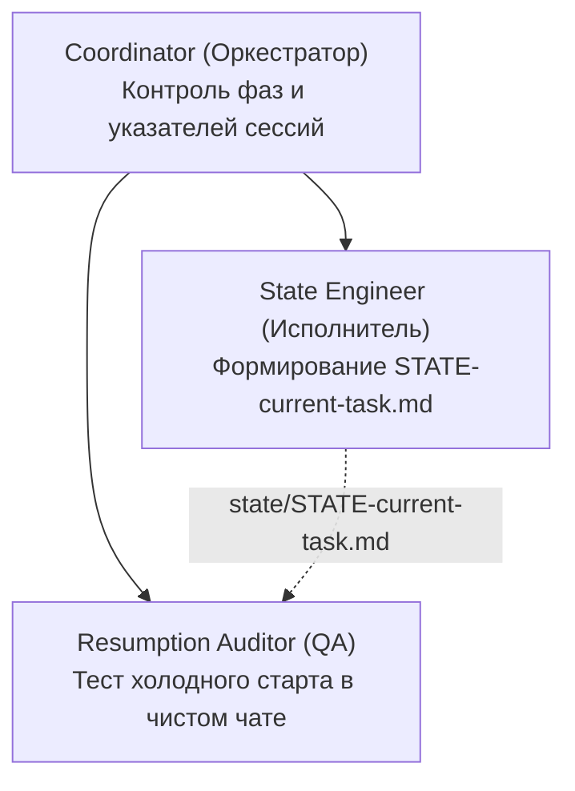

# TICKET-06: Возобновляемость сессии в стиле Manus на базе файлов состояния

## 1. Контекст, проблема и инварианты (Context, Problem & Invariants)

### 1.1. Контекст и бизнес-проблема
В стандартных диалоговых ИИ-ассистентах закрытие окна чата или перезапуск IDE приводит к полной потере оперативного контекста. При реализации масштабных стратегических проектов длительностью в несколько дней или недель продакт-лидер вынужден заново копировать брифы, пересказывать ограничения и восстанавливать цепочку рассуждений. В репозиторной архитектуре агента эта проблема решается детерминированным файловым стейтом в стиле **Manus Context Engineering**: агент фиксирует контрольные точки в файле состояния, обеспечивая мгновенный «холодный старт» в любом чистом окне IDE.

### 1.2. Архитектурные инварианты
- **Zero Memory-Wipe Invariant**: Агент обязан восстанавливать 100% ситуационной осведомленности исключительно по содержимому `state/STATE-current-task.md` и `state/decision-journal.md` без обращения к скрытой истории предыдущего диалога.
- **Sub-Second Recovery**: Объем файла состояния оптимизирован ($\le 35$ строк), считывается моделью за $<1$ секунды и занимает не более 1.5% контекстного окна.
- **Russian Sasha Communication Invariant**: Сообщение о возобновлении сессии формулируется на естественном русском языке в деловом стиле `sasha` без шаблонных клише ("Я ваш ИИ-помощник...").
- **State Monotonicity Invariant**: Чекпоинты состояний обновляются строго монотонно по завершении каждой аналитической фазы (1 $\to$ 6).

---

## 2. Архитектура и топология Team Work (Team Work Topology & Roles)

### 2.1. Ролевая матрица субагентов



| Роль агента | Тип субагента | Зона ответственности | Входные данные | Выходные артефакты | Шаговый бюджет |
| :--- | :--- | :--- | :--- | :--- | :---: |
| **Coordinator** | `strategist` / `self` | Переключение активных фаз (Phase 1–6), фиксация завершенных этапов. | `docs/STATE.md` | `state/STATE-current-task.md` | $\le 5$ шагов |
| **State Engineer** | `coder` / `self` | Поддержание канонической схемы чекпоинта и журнала решений. | Артефакты фазы | `state/STATE-current-task.md`, `state/decision-journal.md` | $\le 8$ шагов |
| **Resumption Auditor** | `verifier` / `self` | Имитация холодного старта: парсинг файла состояния и генерация ответа о статусе. | Файлы состояния `state/` | Отчет о валидности возобновления | $\le 5$ шагов |

### 2.2. Изоляция файловых границ (File Boundary Isolation)
- **State Engineer**: Запись строго в `state/STATE-current-task.md` и `state/decision-journal.md`.
- **Resumption Auditor**: Read-Only доступ к директории `state/`.
- Файлы методологии и проектов остаются изолированными от механизма стейта.

### 2.3. Директива запуска субагентов (Invoke Subagent Directive)
```text
Execute deep session state management and resumption testing.
Enforce Manus-style context engineering: STATE-current-task.md must remain concise (<=35 lines).
Verify that reading only state/ files provides complete situational awareness.
Conclude cleanly once cold-start resumption is proven without in-memory dependency.
```

---

## 3. Детерминированные контракты реализации (Implementation Contracts)

### 3.1. Каноническая схема `state/STATE-current-task.md`
````markdown
# Current Task State & Resumption Pointer

## Task Overview
- **Project**: `<project-slug>`
- **Goal**: `<Краткая цель в 1 предложение>`
- **Active Phase**: `Phase X: <Название фазы> (<STATUS>)`
- **Last Updated**: `YYYY-MM-DDTHH:MM:SSZ`
- **Session Resume Pointer**: `<уникальный идентификатор сессии>`

## Progress Tracker
- [x] TICKET-01: ...
- [ ] TICKET-0X: ...

## Open Questions for Stakeholder
<1-2 открытых вопроса или None>

## Completed Steps
1. <Завершенный шаг 1>
2. <Завершенный шаг 2>

## Next Action
<Следующее конкретное действие агента>
````

### 3.2. Эталонный формат ответа при возобновлении сессии (`skill:session-resume`)
> *«Контекст восстановлен: проект `demo-megafon`, фаза финализации стратегии. Решение DEC-2026-MF-01 утверждено. Все артефакты готовы к запуску пилота. Готов продолжить работу.»*

---

## 4. Криминалистический чеклист приемки (Forensic Acceptance Checklist)

### 4.1. Автоматизированные тесты
```powershell
# 1. Проверка существования и структуры файла состояния
$statePath = "state/STATE-current-task.md"
if (-not (Test-Path $statePath)) { throw "Missing state file: $statePath" }

# 2. Проверка ключевых полей схемы
$stateContent = Get-Content $statePath -Raw
assert ($stateContent.Contains("Session Resume Pointer")) "Missing Session Resume Pointer"
assert ($stateContent.Contains("Active Phase")) "Missing Active Phase"
assert ($stateContent.Contains("Next Action")) "Missing Next Action"

# 3. Тест раннера Team Work для TICKET-06
python scripts/teamwork_runner.py --ticket TICKET-06 --mode live
```

### 4.2. Критерии готовности ("Done When")
- [x] Файл `state/STATE-current-task.md` существует и содержит все обязательные разделы схемы.
- [x] Объем файла состояния не превышает 35 строк.
- [x] Навык `skill:session-resume` считывает файл состояния без ошибок.
- [x] Тест раннера `teamwork_runner.py` для TICKET-06 завершается с кодом 0.
