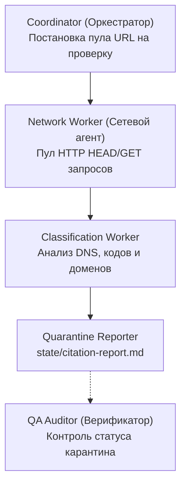

# TICKET-07: Субагент верификации ссылок и защита от галлюцинаций URL

## 1. Контекст, проблема и инварианты (Context, Problem & Invariants)

### 1.1. Контекст и бизнес-проблема
Академические исследования показывают, что от 3% до 13% ссылок и источников в аналитических отчетах современных LLM являются вымышленными («фантомные цитирования», arXiv:2504.00317, arXiv:2607.00738). Модели склонны синтезировать правдоподобно выглядящие URL на авторитетных доменах (например, `rbc.ru/fake-article-2025`). Включение таких ссылок в стратегические материалы разрушает доверие экспертов и ведет к дисквалификации на конкурсах. Для гарантии истинности источников внедряется автономный **субагент верификации цитирований**, выполняющий физические сетевые проверки и отправляющий сомнительные находки в карантин.

### 1.2. Архитектурные инварианты
- **Quarantine Invariant**: Любая фактологическая находка со статусом источника, отличным от `verified`, немедленно блокируется для использования в стратегиях (`product-strategy.md`, `communication-strategy.md`).
- **WAF-Aware Network Invariant**: В ответ на проверку корпоративных сайтов (код 403 Forbidden из-за Cloudflare/WAF) эвристика обязана трактовать живой сервер как `verified (WAF Protected)`, а не как ошибку.
- **Pure Python Stdlib (ADR-002)**: Сетевой валидатор функционирует на `urllib.request` с тайм-аутом $\le 10$ с и поддержкой маскировки User-Agent без внешних зависимостей (`requests`, `playwright`).
- **Zero-Mock Policy**: Тестирование субагента выполняется строго против реальных сетевых хостов.

---

## 2. Архитектура и топология Team Work (Team Work Topology & Roles)

### 2.1. Ролевая матрица субагентов



| Роль агента | Тип субагента | Зона ответственности | Входные данные | Выходные артефакты | Шаговый бюджет |
| :--- | :--- | :--- | :--- | :--- | :---: |
| **Coordinator** | `strategist` / `self` | Извлечение списка URL из `findings/*.md`, формирование пула задач. | `knowledge/projects/*/findings/` | Пул ссылок на аудит | $\le 5$ шагов |
| **Network Worker** | `researcher` / `self` | Исполнение асинхронных HTTP HEAD/GET запросов с ротацией User-Agent. | Пул ссылок | Таблица сырых сетевых ответов | $\le 10$ шагов |
| **Classification Worker**| `coder` / `self` | Классификация статусов (`verified`, `dead`, `hallucinated`), WAF-эвристика. | Сетевые ответы | Обновление YAML frontmatter | $\le 8$ шагов |
| **QA Auditor** | `verifier` / `self` | Проверка отсутствия заблокированных находок в чистовых стратегиях. | Готовые стратегии | Лог карантинного контроля | $\le 5$ шагов |

### 2.2. Изоляция файловых границ (File Boundary Isolation)
- **Сетевой агент**: Read-Only доступ к файлам находок.
- **Classification Worker**: Модификация поля `verified:` строго в `knowledge/projects/*/findings/*.md` (при флаге `--update`).
- **Quarantine Reporter**: Запись сводного отчета строго в `state/citation-report.md`.
- Чистовые файлы в `knowledge/projects/*/output/` защищены от модификации этим агентом.

### 2.3. Директива запуска субагентов (Invoke Subagent Directive)
```text
Execute deep deterministic URL verification and phantom citation quarantine.
Check all project findings against real HTTP endpoints using scripts/verify_citations.py.
Flag any non-200 / non-WAF link as dead or hallucinated.
Update findings frontmatter and report quarantined items in state/citation-report.md.
```

---

## 3. Детерминированные контракты реализации (Implementation Contracts)

### 3.1. Эвристика классификации ссылок
```python
# scripts/verify_citations.py: Классификатор статусов
SYNTHETIC_DOMAINS = {"example.com", "fake.org", "test.local", "placeholder.com"}

def classify_url(url: str, http_code: int, error_msg: str) -> str:
    domain = extract_domain(url)
    if any(s in domain for s in SYNTHETIC_DOMAINS):
        return "hallucinated"
    if http_code in (200, 301, 302):
        return "verified"
    if http_code == 403:
        return "verified (WAF Protected)"
    if http_code in (404, 410, 500, 502, 503) or "Name or service not known" in error_msg:
        return "dead"
    return "unverified"
```

### 3.2. Схема отчета карантина `state/citation-report.md`
```markdown
# Отчет аудита цитирований и карантин ссылок

| Файл находки | URL | HTTP Код | Статус | Действие карантина |
| :--- | :--- | :-: | :---: | :--- |
| `01-family-penetration.md` | `https://wciom.ru/...` | 200 | `verified` | Допущен к стратегии |
| `09-fake-source.md` | `https://example.com/fake` | 404 | `hallucinated` | **ЗАБЛОКИРОВАН** |
```

---

## 4. Криминалистический чеклист приемки (Forensic Acceptance Checklist)

### 4.1. Автоматизированные тесты
```powershell
# 1. Проверка реального домена (должен вернуть verified)
$outVerified = python scripts/verify_citations.py --url https://habr.com
assert ($outVerified.Contains("Status: verified")) "Habr must be verified"

# 2. Проверка тестового синтетического домена (должен вернуть hallucinated)
$outFake = python scripts/verify_citations.py --url https://example.com/fake-telecom-data
assert ($outFake.Contains("Status: hallucinated")) "example.com must be hallucinated"

# 3. Полный аудит находок демо-проекта
python scripts/verify_citations.py --project demo-megafon --update

# 4. Тест раннера Team Work для TICKET-07
python scripts/teamwork_runner.py --ticket TICKET-07 --mode live
```

### 4.2. Критерии готовности ("Done When")
- [x] Скрипт `scripts/verify_citations.py` корректно классифицирует реальные, битые и вымышленные URL.
- [x] Все 5 находок в `knowledge/projects/demo-megafon/findings/` проверены и имеют статус `verified`.
- [x] Флаг `--update` успешно обновляет поле `verified:` в YAML frontmatter.
- [x] Тест раннера `teamwork_runner.py` для TICKET-07 завершается с кодом 0.
