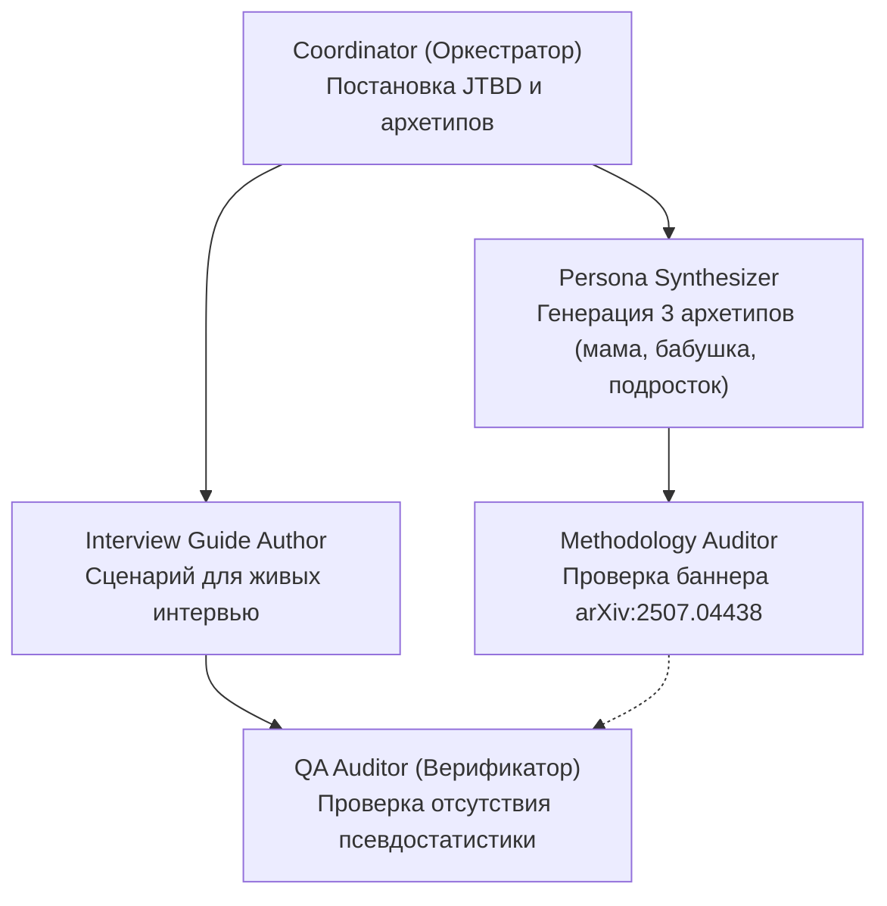

# TICKET-08: Панель синтетических респондентов с честной маркировкой

## 1. Контекст, проблема и инварианты (Context, Problem & Invariants)

### 1.1. Контекст и бизнес-проблема
Многие современные ИИ-стартапы выдают диалоги с нейросетевыми персонажами за «подтверждение продуктового спроса» и рыночную валидацию. Однако фундаментальные исследования (Chen, Zhu, Zheng, arXiv:2507.04438 / arXiv:2607.26348) доказали, что языковые модели страдают неизбежным конформизмом (hypothetical compliance bias) и не обладают реальными бюджетными ограничениями. Исследования Verasight (2026) зафиксировали ошибку синтетических опросов в RMSE 8.3 процентных пункта. Для защиты от самообмана и соблюдения конкурсных стандартов синтетические респонденты позиционируются строго как инструмент **качественной генерации гипотез и выявления скрытых барьеров**, с обязательным неустранимым дисклеймером и разработкой гайда для проверки на реальных людях.

### 1.2. Архитектурные инварианты
- **Mandatory Disclaimer Banner Invariant**: Любой документ или отчет, содержащий ответы синтетических персон, обязан начинаться с официального предупреждения об ограничениях симуляции.
- **Strictly No-WTP (Willingness-to-Pay) Invariant**: Категорически запрещено использовать ответы LLM-персон для расчета готовности платить, эластичности цен или объема целевого рынка.
- **Empirical Off-Ramp Invariant**: Каждая сессия синтетических респондентов обязана завершаться формированием сценария качественного интервью для валидации на живых абонентах.
- **Zero-Mock Policy**: Персоны моделируются на основе реальных демографических архетипов домохозяйств РФ.

---

## 2. Архитектура и топология Team Work (Team Work Topology & Roles)

### 2.1. Ролевая матрица субагентов



| Роль агента | Тип субагента | Зона ответственности | Входные данные | Выходные артефакты | Шаговый бюджет |
| :--- | :--- | :--- | :--- | :--- | :---: |
| **Coordinator** | `strategist` / `self` | Определение целевых сегментов и формулировка исследовательских задач. | `knowledge/projects/*/brief.md` | Задание на симуляцию | $\le 5$ шагов |
| **Persona Synthesizer** | `coder` / `self` | Генерация 3 проработанных архетипов с картами эмпатии и страхами. | Методология `synthetic-respondents.md` | `data/synthetic-panel.md` | $\le 8$ шагов |
| **Interview Guide Author**| `researcher` / `self` | Составление гайда очного глубинного интервью для проверки гипотез на людях. | Профили персон | Блок гайда в `synthetic-panel.md` | $\le 6$ шагов |
| **Methodology Auditor** | `verifier` / `self` | Проверка наличия обязательного дисклеймера и ссылок на академические работы. | Сгенерированный документ | Вердикт соответствия | $\le 5$ шагов |
| **QA Auditor** | `verifier` / `self` | Аудит текста на отсутствие псевдо-статистических выводов («70% купят тариф»). | Финальный документ | Лог аудита чистоты метрик | $\le 5$ шагов |

### 2.2. Изоляция файловых границ (File Boundary Isolation)
- **Persona Synthesizer**: Запись строго в `knowledge/projects/*/data/synthetic-panel.md`.
- **Methodology Auditor & QA**: Read-Only доступ.
- Файлы методологии `knowledge/methodology/synthetic-respondents.md` иммутабельны во время работы субагентов проекта.

### 2.3. Директива запуска субагентов (Invoke Subagent Directive)
```text
Execute deep synthetic persona simulation strictly for qualitative hypothesis generation.
Ensure the mandatory methodological disclaimer banner (citing arXiv:2507.04438) is present at the very top.
Prohibit any numeric market sizing or willingness-to-pay calculations from synthetic dialogues.
Conclude with an empirical customer interview guide for in-person validation.
```

---

## 3. Детерминированные контракты реализации (Implementation Contracts)

### 3.1. Обязательный дисклеймер (Mandatory Disclaimer Banner)
```markdown
> [!WARNING]
> **МЕТОДОЛОГИЧЕСКИЙ ДИСКЛЕЙМЕР: СИНТЕТИЧЕСКАЯ СИМУЛЯЦИЯ ПЕРСОН**
> Данные профили респондентов и протоколы ответов сгенерированы синтетически с помощью ИИ **ИСКЛЮЧИТЕЛЬНО для качественного поиска гипотез и выявления скрытых когнитивных барьеров**.
> В соответствии со стандартами научной доказательности (arXiv:2507.04438 / arXiv:2607.26348) синтетические ответы **НЕ ЯВЛЯЮТСЯ** подтверждением потребительского спроса, готовности платить (WTP) или валидацией рынка. Для принятия инвестиционных решений обязательна очная проверка на реальных пользователях по приведенному ниже гайду.
```

### 3.2. Требования к архетипам домохозяйства («МегаФон Семья 2.0»)
1. **«Глава семьи / Организатор» (38 лет)**: Ответственная за бюджет, ключевой страх — платная подписка и списание с общего баланса, гипотеза о критичности антиспама.
2. **«Пожилой родственник» (68 лет)**: Кнопочный телефон/планшет, страх потери своего архивного номера и сложных интерфейсов, гипотеза о бесшовном онбординге.
3. **«Подросток» (14 лет)**: Высокое потребление трафика, страх родительской слежки и ограничений, гипотеза о разделении приватности и общего пакета интернета.

---

## 4. Криминалистический чеклист приемки (Forensic Acceptance Checklist)

### 4.1. Автоматизированные тесты
```powershell
# 1. Проверка наличия документа методологии и демо-панели
$panelPath = "knowledge/projects/demo-megafon/data/synthetic-panel.md"
if (-not (Test-Path $panelPath)) { throw "Missing synthetic panel file: $panelPath" }

# 2. Проверка обязательного предупреждающего дисклеймера
$panelContent = Get-Content $panelPath -Raw
assert ($panelContent.Contains("МЕТОДОЛОГИЧЕСКИЙ ДИСКЛЕЙМЕР")) "Missing mandatory disclaimer banner"
assert ($panelContent.Contains("arXiv:2507.04438")) "Missing arXiv:2507.04438 citation"

# 3. Проверка наличия гайда для живых интервью
assert ($panelContent.Contains("Гайд для валидации с реальными респондентами")) "Missing in-person interview guide"

# 4. Тест раннера Team Work для TICKET-08
python scripts/teamwork_runner.py --ticket TICKET-08 --mode live
```

### 4.2. Критерии готовности ("Done When")
- [x] В `knowledge/projects/demo-megafon/data/synthetic-panel.md` содержатся 3 проработанных архетипа.
- [x] Документ открывается обязательным предупреждающим баннером.
- [x] Полностью отсутствуют псевдостатистические суждения об объемах рынка на основе симуляции.
- [x] Документ включает 4-блочный гайд очного интервью для полевой проверки.
- [x] Тест раннера `teamwork_runner.py` для TICKET-08 завершается с кодом 0.
