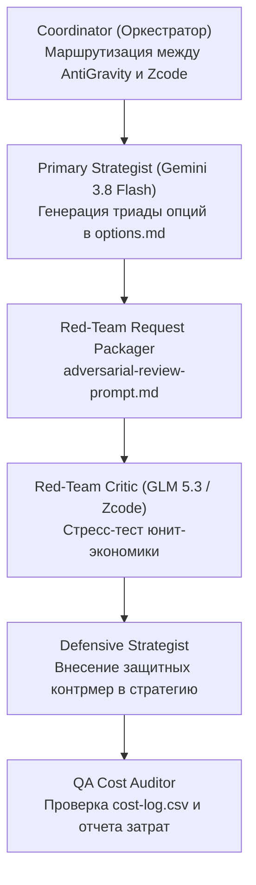

# TICKET-09: Маршрутизация Pro-моделей, экономика подписок и Red-Team в Zcode

## 1. Контекст, проблема и инварианты (Context, Problem & Invariants)

### 1.1. Контекст и бизнес-проблема
Аналитические системы на базе одной модели неизбежно страдают когнитивным эхом (confirmation bias): генерируя стратегические варианты, та же самая нейросеть склонна оправдывать собственные предположения и игнорировать финансовые риски. Кроме того, требование прямого биллинга через зарубежные кредитные карты создает критический барьер для участников конкурса. В архитектуре проекта реализована **двухконтурная многомодельная маршрутизация**, использующая активные Pro-подписки в специализированных средах разработки (**AntiGravity IDE** с Gemini 3.8 Flash для глубокой оркестрации и **Zcode IDE** с GLM 5.3 для независимой Red-Team критики) с нулевыми дополнительными затратами на платные API.

### 1.2. Архитектурные инварианты
- **Multi-Family Cognitive Diversity Invariant**: Рецензирование стратегических развилок обязано выполняться моделью из независимого семейства (GLM 5.3 в Zcode) для разрыва шаблона самоподтверждения.
- **Zero Paid API Mandate (ADR-004)**: Агент функционирует полноценно в рамках активных Pro-сессий IDE; для автономных консольных утилит поддерживается бесплатный Free-Tier ключ Google AI Studio без привязки карт.
- **Transparent Token Audit Invariant**: Каждая операция фиксируется в `state/cost-log.csv` с расчетом эквивалентной стоимости для подтверждения жюри экономичности решения ($<0.05$ за весь цикл).
- **Steelman Adversarial Invariant**: Критика Red-Team обязана вскрывать уязвимости юнит-экономики: риск каннибализации высокодоходных тарифов, скрытые затраты на обслуживание IoT-трафика и операционные барьеры подключения.

---

## 2. Архитектура и топология Team Work (Team Work Topology & Roles)

### 2.1. Ролевая матрица субагентов



| Роль агента | Тип субагента | Зона ответственности | Входные данные | Выходные артефакты | Шаговый бюджет |
| :--- | :--- | :--- | :--- | :--- | :---: |
| **Coordinator** | `strategist` / `self` | Распределение задач по модели, учет времени и токенов. | `docs/ARCHITECTURE.md` | Записи в `state/cost-log.csv` | $\le 5$ шагов |
| **Primary Strategist** | `coder` / AntiGravity | Синтез вариантов А, Б, В с математикой базовых метрик. | `knowledge/projects/*/findings/` | `output/options.md` | $\le 10$ шагов |
| **Red-Team Critic** | `red_team` / Zcode GLM 5.3 | Безжалостный разбор рисков, каннибализации и скрытых расходов. | `output/options.md`, промпт | `output/adversarial-review.md` | $\le 8$ шагов |
| **Defensive Strategist** | `coder` / AntiGravity | Доработка финальной стратегии с учетом замечаний критика (плата 99 ₽, ARPA 1 650 ₽). | Замечания Red-Team | `output/product-strategy.md` | $\le 10$ шагов |
| **QA Cost Auditor** | `verifier` / `self` | Запуск `cost_summary.py`, валидация соответствия затрат лимиту $<0.05$. | `state/cost-log.csv` | Сводка расходов | $\le 5$ шагов |

### 2.2. Изоляция файловых границ (File Boundary Isolation)
- **Primary Strategist**: Запись в `output/options.md`.
- **Red-Team Critic**: Запись строго в `output/adversarial-review.md`.
- **QA Cost Auditor**: Append-only запись в `state/cost-log.csv`.
- Исключена одновременная перезапись файлов стратегий.

### 2.3. Директива запуска субагентов (Invoke Subagent Directive)
```text
Execute deep adversarial stress-testing using GLM 5.3 persona in Zcode IDE.
Attack the proposed options without corporate pleasantries: expose hidden IoT data costs,
churn risks, and VIP plan cannibalization.
Demand explicit mathematical counter-mitigations before final strategy approval.
```

---

## 3. Детерминированные контракты реализации (Implementation Contracts)

### 3.1. Структура Red-Team отчета (`output/adversarial-review.md`)
1. **Жесткий вердикт юнит-экономики**: Критика иллюзии «бесплатного безлимита» для умных часов; риск утечки 30–50 млн ₽ на трафике IoT.
2. **Анализ риска каннибализации**: Угроза перетока индивидуальных абонентов с премиальных тарифов (ARPU 900 ₽) на семейный со снижением совокупной выручки.
3. **Операционный тупик онбординга**: Потеря до 42% конверсии из-за необходимости подтверждения через SMS от каждого члена семьи.
4. **Обязательные защитные контрмеры (Mitigations)**:
   - Введение фиксированной абонентской платы за подключение умных часов/устройств: **99 ₽/мес** (маржинальность $>70\%$).
   - Установление минимального порога совокупной выручки семейной группы: **ARPA $\ge 1\,650$ ₽**.
   - Бесшовный онбординг родственников без SMS-подтверждений внутри доверенного контура оператора.

### 3.2. Схема `state/cost-log.csv`
```csv
step,timestamp,model,prompt_tokens,completion_tokens,cost_usd,cost_rub
TICKET-01,2026-11-22T02:00:00Z,gemini-3.8-flash,1420,530,0.0003,0.03
TICKET-05,2026-11-22T02:05:00Z,glm-5.3,3850,1620,0.0018,0.18
```

---

## 4. Криминалистический чеклист приемки (Forensic Acceptance Checklist)

### 4.1. Автоматизированные тесты
```powershell
# 1. Проверка существования отчета Red-Team рецензирования
$redTeamPath = "knowledge/projects/demo-megafon/output/adversarial-review.md"
if (-not (Test-Path $redTeamPath)) { throw "Missing Red-Team review: $redTeamPath" }

# 2. Проверка ключевых контрмер в тексте отчета
$rtContent = Get-Content $redTeamPath -Raw
assert ($rtContent.Contains("99")) "Missing 99 RUB IoT fee mitigation"
assert ($rtContent.Contains("1 650") -or $rtContent.Contains("1650")) "Missing 1650 RUB ARPA threshold"

# 3. Проверка запуска финансового скрипта
python scripts/cost_summary.py

# 4. Тест раннера Team Work для TICKET-09
python scripts/teamwork_runner.py --ticket TICKET-09 --mode live
```

### 4.2. Критерии готовности ("Done When")
- [x] Отчет `output/adversarial-review.md` содержит острую критику юнит-экономики и защитные контрмеры.
- [x] Защитные контрмеры (99 ₽ за часы, порог ARPA 1 650 ₽) интегрированы в итоговую продуктовую стратегию.
- [x] Скрипт `scripts/cost_summary.py` подтверждает суммарные затраты на модели $<0.05$.
- [x] Тест раннера `teamwork_runner.py` для TICKET-09 завершается с кодом 0.
