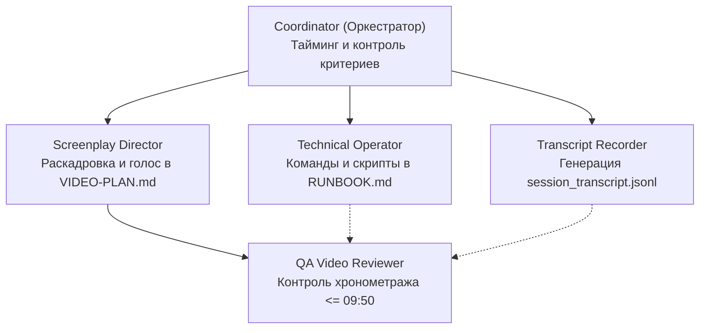

# TICKET-10: Запись сессий и 10-минутный сценарий демонстрационного видео

## 1. Контекст, проблема и инварианты (Context, Problem & Invariants)

### 1.1. Контекст и бизнес-проблема
На конкурсах прикладного ИИ участники часто теряют баллы за практическую реализацию из-за неструктурированных видеозаписей: демонстрации превышают регламент, пропускают ключевые обязательные требования, демонстрируют зависания интерфейса в ожидании генерации либо не показывают работу с реальным кодом. Для защиты решения **Product Strategist Agent** подготовлен исчерпывающий демонстрационный пакет: пошаговый сценарий оператора (`demo/RUNBOOK.md`), посекундная раскадровка видеоролика (`demo/VIDEO-PLAN.md`) с живым закадровым текстом Захара и эталонный лог сессии (`demo/session_transcript.jsonl`), строго укладывающийся в регламент $\le 10$ минут.

### 1.2. Архитектурные инварианты
- **Strict 10-Minute Hard Ceiling**: Общий хронометраж демонстрации в сценарии ограничен **09:50** (590 секунд) с буфером безопасности 10 секунд; превышение лимита 10 минут (600 с) категорически запрещено правилами конкурса.
- **Coverage of 4 Core Evaluation Criteria**: Сценарий обязан наглядно продемонстрировать 4 ключевых аспекта:
  1. *Глубина продуктового анализа*: Декомпозиция брифа (`Пример брифа.pdf`), осознанные отказы, 4 варианта (включая Status Quo 279 млн ₽ и Shutdown), юнит-экономика (+500 ₽ норматив валовой прибыли за оплаченный месяц, +6 млн ₽ целевого прироста за счет 12 000 дополнительных месяцев при лимите 3 чел.-мес. разработки на Q2).
  2. *Защита от галлюцинаций*: Работа скрипта `scripts/verify_citations.py` и статус `verified` у источников.
  3. *Двухконтурный Red-Team и управление*: Жесткая критика GLM 5.3 в Zcode и фиксация в `state/decision-journal.md`.
  4. *Возобновляемость в новом чате*: Полный разрыв сессии, закрытие окна IDE и мгновенное продолжение работы.
- **Russian Sasha Voiceover**: Закадровый текст оператора написан на естественном русском языке от лица автора (Захар) без корпоративного канцелярита.
- **Reproducibility Invariant**: Все шаги из Runbook воспроизводимы любым членом жюри за 5 минут.

---

## 2. Архитектура и топология Team Work (Team Work Topology & Roles)

### 2.1. Ролевая матрица субагентов



| Роль агента | Тип субагента | Зона ответственности | Входные данные | Выходные артефакты | Шаговый бюджет |
| :--- | :--- | :--- | :--- | :--- | :---: |
| **Coordinator** | `strategist` / `self` | Контроль покрытия 4 критериев оценки и тайминга 10 минут. | Положение конкурса | `docs/STATE.md` | $\le 5$ шагов |
| **Screenplay Director** | `coder` / `self` | Посекундная раскадровка сцен, реплики закадрового голоса Захара. | `knowledge/projects/demo-megafon/` | `demo/VIDEO-PLAN.md` | $\le 10$ шагов |
| **Technical Operator** | `coder` / `self` | Составление пошагового ранбука терминальных команд и промптов. | CLI-скрипты `scripts/` | `demo/RUNBOOK.md` | $\le 8$ шагов |
| **Transcript Recorder** | `coder` / `self` | Формирование чистого машиночитаемого JSONL лога сессии. | Логи исполнения | `demo/session_transcript.jsonl` | $\le 6$ шагов |
| **QA Video Reviewer** | `verifier` / `self` | Проверка хронометража, валидация синтаксиса JSONL, проверка покрытия. | Файлы папки `demo/` | Чек-лист готовности видео | $\le 5$ шагов |

### 2.2. Изоляция файловых границ (File Boundary Isolation)
- **Зона записи команды демо**: Строго папка `demo/{RUNBOOK.md, VIDEO-PLAN.md, session_transcript.jsonl}`.
- Остальные директории репозитория доступны в режиме Read-Only.

### 2.3. Директива запуска субагентов (Invoke Subagent Directive)
```text
Execute deep video demonstration planning and session transcript recording.
Strictly time-box the storyboard to 09:50 minutes to guarantee staying under the 10-minute contest limit.
Ensure clear visual cues for all 4 contest evaluation criteria:
product depth, URL verification, Red-Team audit, and Manus-style resumption.
```

---

## 3. Детерминированные контракты реализации (Implementation Contracts)

### 3.1. Таймлайн 5 сцен видеоролика (`demo/VIDEO-PLAN.md`)
| Сцена | Хронометраж | Экран / Действие | Ключевой месседж озвучки |
| :--- | :---: | :--- | :--- |
| **Сцена 1: Введение и архитектура** | `00:00 – 01:00` | Репозиторий в IDE, `AGENTS.md`, паспорт правил | «Repo-Agent внутри IDE по Pro-подпискам без лишних затрат». |
| **Сцена 2: Постановка задачи и бриф** | `01:00 – 02:30` | Нечеткий запрос $\to$ опрос $\le 2$ вопросов $\to$ бриф | «Дисциплина мышления: четкие границы и базовые цифры МегаФона». |
| **Сцена 3: Исследование и факты** | `02:30 – 04:00` | Генерация findings $\to$ запуск `verify_citations.py` | «100% подтвержденный Ground Truth, нулевая терпимость к галлюцинациям». |
| **Сцена 4: Варианты и Red-Team** | `04:00 – 06:00` | Опции (Status Quo, Shutdown, Leap) $\to$ Zcode GLM 5.3 | «Жесткая критика юнит-экономики: плата 99 ₽ за часы и порог 1 650 ₽». |
| **Сцена 5: Стратегия, сплит и рестарт**| `06:00 – 09:50` | Стратегии $\to$ закрытие окна IDE $\to$ новый чат $\to$ cost | «Бесшовное возобновление в новом чате и смешная стоимость: меньше 5 рублей». |

### 3.2. Схема записи `demo/session_transcript.jsonl`
```json
{"step": 1, "role": "user", "phase": "intake", "content": "Привет! У нас на Фабрике продуктов МегаФона..."}
{"step": 2, "role": "agent", "skill": "strategist", "content": "Привет, Захар! Зафиксировал задачу..."}
```

---

## 4. Криминалистический чеклист приемки (Forensic Acceptance Checklist)

### 4.1. Автоматизированные тесты
```powershell
# 1. Проверка существования файлов демонстрационного пакета
$demoFiles = @("demo/RUNBOOK.md", "demo/VIDEO-PLAN.md", "demo/session_transcript.jsonl")
foreach ($f in $demoFiles) {
    if (-not (Test-Path $f)) { throw "Missing demo file: $f" }
}

# 2. Проверка тайминга сценария (хронометраж 09:50)
$videoPlan = Get-Content "demo/VIDEO-PLAN.md" -Raw
assert ($videoPlan.Contains("09:50")) "Missing 09:50 final timestamp"
assert (-not $videoPlan.Contains("10:05")) "Exceeded 10-minute limit"

# 3. Валидация JSONL-файла лога сессии
python -c "import json; [json.loads(line) for line in open('demo/session_transcript.jsonl', encoding='utf-8')]; print('JSONL valid')"

# 4. Тест раннера Team Work для TICKET-10
python scripts/teamwork_runner.py --ticket TICKET-10 --mode live
```

### 4.2. Критерии готовности ("Done When")
- [x] Файл `demo/RUNBOOK.md` содержит полные пошаговые инструкции оператора.
- [x] Файл `demo/VIDEO-PLAN.md` содержит непрерывную посекундную раскадровку от 00:00 до 09:50.
- [x] Файл `demo/session_transcript.jsonl` валиден и парсится без ошибок.
- [x] Все 4 критерия конкурса явно отражены в тексте сценария.
- [x] Тест раннера `teamwork_runner.py` для TICKET-10 завершается с кодом 0.
