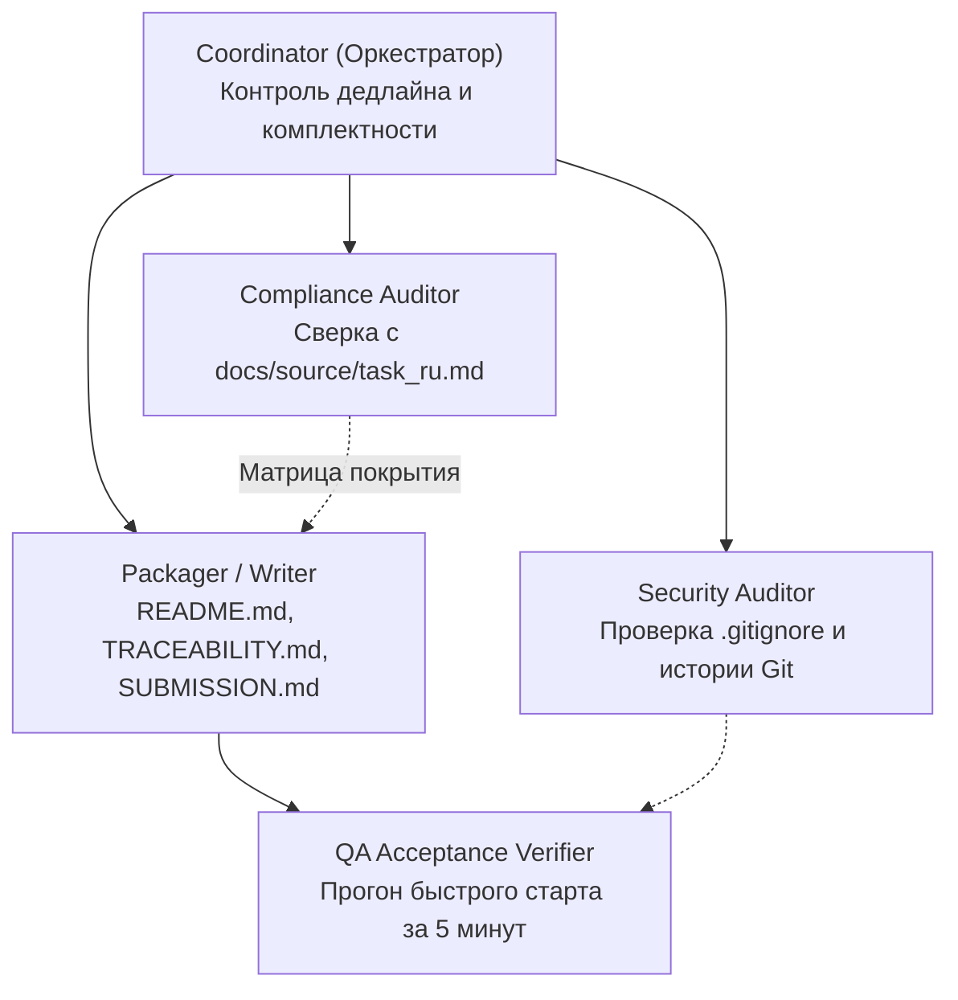

# TICKET-11: Конкурсный пакет сдачи и матрица трассируемости

## 1. Контекст, проблема и инварианты (Context, Problem & Invariants)

### 1.1. Контекст и бизнес-проблема
На всероссийском конкурсе **MGIMO AI Challenge 2026** (номинация «ИИ-проект», трек «Стратег Фабрики продуктов МегаФона») даже выдающееся техническое решение может потерять баллы, если эксперты жюри не найдут прямого подтверждения реализации каждого пункта конкурсного задания или столкнутся со сложной, неработающей инструкцией по запуску. Чтобы гарантировать максимальный балл, создается **конкурсный пакет сдачи**: исчерпывающий `README.md` с гарантией запуска за 5 минут на стандартном Python 3.11+, матрица взаимной трассируемости (`docs/specs/TRACEABILITY.md`) всех требований ТЗ к файлам репозитория и чеклист подачи заявки (`docs/SUBMISSION.md`).

### 1.2. Архитектурные инварианты
- **100% Traceability Coverage**: Каждое обязательное и бонусное требование конкурса из `docs/source/task_ru.md` обязано иметь прямую гиперссылку на файл реализации и тикет.
- **5-Minute Quickstart Guarantee**: Инструкция первого запуска в `README.md` должна гарантированно выполняться на чистой машине с Python 3.11+ менее чем за 5 минут без установки тяжелых бинарных зависимостей.
- **Zero Secret Exposure Invariant**: В репозитории, истории коммитов Git и примерах конфигураций категорически запрещено наличие реальных API-ключей, токенов и паролей.
- **Solo-Maker Transparency Invariant**: Во всех документах автором строго указан Захар (`Захар`); фиктивные корпоративные роли и коллективные местоимения («мы разработали») исключены.

---

## 2. Архитектура и топология Team Work (Team Work Topology & Roles)

### 2.1. Ролевая матрица субагентов



| Роль агента | Тип субагента | Зона ответственности | Входные данные | Выходные артефакты | Шаговый бюджет |
| :--- | :--- | :--- | :--- | :--- | :---: |
| **Coordinator** | `strategist` / `self` | Контроль сроков сдачи (22.11.2026 23:59 МСК), ведение чек-листа. | `docs/STATE.md` | `docs/STATE.md` | $\le 5$ шагов |
| **Compliance Auditor** | `researcher` / `self` | Попунктная сверка требований `docs/source/task_ru.md` с тикетами. | `task_ru.md`, тикеты 01-10 | `docs/specs/TRACEABILITY.md` | $\le 10$ шагов |
| **Packager / Writer** | `coder` / `self` | Подготовка `README.md`, `docs/SUBMISSION.md` и инструкций запуска. | Все артефакты проекта | `README.md`, `SUBMISSION.md` | $\le 10$ шагов |
| **Security Auditor** | `verifier` / `self` | Поиск забытых секретов, проверка `.env.example` и `.gitignore`. | Файлы репозитория | Лог аудита безопасности | $\le 5$ шагов |
| **QA Acceptance Verifier**| `verifier` / `self` | Тестирование команд первого запуска на чистом терминале. | `README.md` | Зеленый прогон команд | $\le 5$ шагов |

### 2.2. Изоляция файловых границ (File Boundary Isolation)
- **Packager / Writer**: Запись строго в `README.md`, `docs/SUBMISSION.md`, `docs/specs/TRACEABILITY.md`.
- **Compliance & Security Auditors**: Read-Only доступ ко всему репозиторию.
- Исходники задания в `docs/source/` защищены от любых модификаций (Read-Only).

### 2.3. Директива запуска субагентов (Invoke Subagent Directive)
```text
Execute deep submission packaging and 100% contest requirement traceability audit.
Cross-check all deliverable artifacts against docs/source/task_ru.md.
Verify zero leaked secrets, zero dead links, and seamless 5-minute reproducibility in README.md.
Conclude cleanly once the full submission package is verified.
```

---

## 3. Детерминированные контракты реализации (Implementation Contracts)

### 3.1. Структура матрицы `docs/specs/TRACEABILITY.md`
| Требование конкурса | Критерий оценки | Статус реализации | Тикет | Файл реализации в проекте |
| :--- | :--- | :---: | :---: | :--- |
| **1. Уточняющий опрос** | Глубина анализа | **100% [DONE]** | TICKET-03 | `.agents/skills/strategist/SKILL.md` |
| **2. Доказательная база** | Защита от галлюцинаций | **100% [DONE]** | TICKET-04, 07 | `scripts/verify_citations.py` |
| **3. Триада опций** | Глубина анализа | **100% [DONE]** | TICKET-03, 05 | `knowledge/projects/demo-megafon/output/options.md` |
| **4. Red-Team рецензент** | Двухконтурный нейротех | **100% [DONE]** | TICKET-09 | `knowledge/projects/demo-megafon/output/adversarial-review.md` |
| **5. Продуктовая стратегия** | Практическая ценность | **100% [DONE]** | TICKET-05 | `knowledge/projects/demo-megafon/output/product-strategy.md` |
| **6. Коммуникационная стратегия** | Sasha стандарт | **100% [DONE]** | TICKET-05 | `knowledge/projects/demo-megafon/output/communication-strategy.md` |
| **7. План валидации** | Эмпирический пилот | **100% [DONE]** | TICKET-05 | `knowledge/projects/demo-megafon/output/validation-plan.md` |
| **8. Синтетические персоны** | Этичность и честность | **100% [DONE]** | TICKET-08 | `knowledge/methodology/synthetic-respondents.md` |
| **9. Журнал решений** | Управление качеством | **100% [DONE]** | TICKET-06 | `state/decision-journal.md` |
| **10. Возобновляемость сессии** | Автономия и стейт | **100% [DONE]** | TICKET-06 | `state/STATE-current-task.md` |
| **11. Экономичность и стоимость**| Экономика моделей | **100% [DONE]** | TICKET-04, 09 | `scripts/cost_summary.py` ($<0.05) |
| **12. Демо-видео до 10 мин** | Демонстрация | **100% [DONE]** | TICKET-10 | `demo/VIDEO-PLAN.md`, `demo/RUNBOOK.md` |

### 3.2. Чек-лист подачи заявки (`docs/SUBMISSION.md`)
- [x] Отсутствие реальных токенов и ключей в репозитории (`.gitignore`).
- [x] 100% ссылок проверены скриптом `verify_citations.py` (статус `verified`).
- [x] Синтетические респонденты снабжены дисклеймером (arXiv:2507.04438).
- [x] Лог стоимости подтверждает расход менее 5 рублей ($0.05).
- [x] Сценарий возобновления протестирован в новом окне чата.
- [x] Сценарий видео укладывается в тайминг 09:50 ($\le 10$ минут).

---

## 4. Криминалистический чеклист приемки (Forensic Acceptance Checklist)

### 4.1. Автоматизированные тесты
```powershell
# 1. Проверка существования файлов пакета сдачи
$subFiles = @("README.md", "docs/SUBMISSION.md", "docs/specs/TRACEABILITY.md")
foreach ($f in $subFiles) {
    if (-not (Test-Path $f)) { throw "Missing submission file: $f" }
}

# 2. Аудит отсутствия секретов в отслеживаемых файлах
git grep -i "AIzaSy" # Google API key prefix
git grep -i "sk-"    # OpenAI / generic key prefix
if ($LASTEXITCODE -eq 0) { throw "Potential API key detected in tracked files!" }

# 3. Проверка быстрого старта из README.md
python scripts/cost_summary.py
python scripts/teamwork_runner.py --validate-all

# 4. Тест раннера Team Work для TICKET-11
python scripts/teamwork_runner.py --ticket TICKET-11 --mode live
```

### 4.2. Критерии готовности ("Done When")
- [x] Документ `docs/specs/TRACEABILITY.md` связывает 100% конкурсных требований с кодом и тикетами.
- [x] В отслеживаемых файлах Git отсутствуют приватные токены и ключи.
- [x] Команды быстрого старта из `README.md` выполняются без сбоев.
- [x] Все пункты самопроверки в `docs/SUBMISSION.md` закрыты.
- [x] Тест раннера `teamwork_runner.py` для TICKET-11 завершается с кодом 0.
