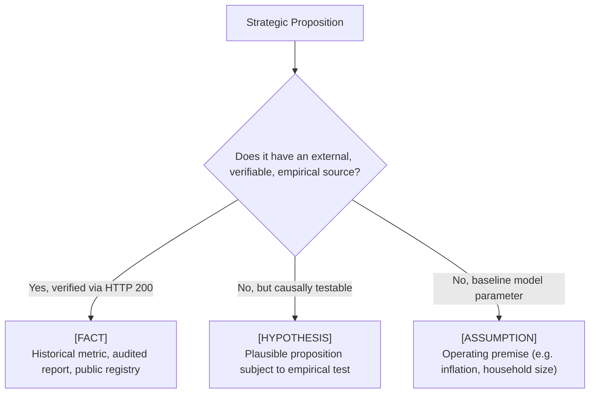

# Epistemic & Evidence Standards

This document establishes the scientific and methodological foundations for empirical research, evidence evaluation, and anti-hallucination guardrails in the **Product Strategist Agent**.

---

## 1. Academic Grounding & The Hallucination Crisis in AI Research

Autonomous AI agents frequently generate persuasive yet fabricated citations. Recent empirical research reveals severe failure modes in LLM-driven research:

1. **Hallucinated URLs in Autonomous Research Reports** ([arXiv:2504.00317](https://arxiv.org/abs/2504.00317)):
   - Analysis of frontier autonomous deep-research systems demonstrates a **3.2% to 13.4% hallucination rate** for referenced web URLs.
   - Fabricated links either lead to dead 404 domains, parking pages, or completely unrelated articles.

2. **Orchestrator-Level Error Cascades** ([arXiv:2608.24306](https://arxiv.org/abs/2608.24306)):
   - **84.7% of factual errors** in final multi-agent strategy deliverables originate at the orchestrator/evidence-collection level, rather than during final prose synthesis.
   - Once a single false metric or fictitious market share is accepted into working memory, downstream reasoning modules uncritically build entire business models upon it.

3. **Empirical Failure of Synthetic Respondents as Demand Predictors** ([Chen, Zhu, & Zheng, arXiv:2507.04438](https://arxiv.org/abs/2507.04438)):
   - LLM-generated personas exhibit severe compliance bias, social desirability distortion, and inability to simulate budget constraints.
   - In benchmarked consumer studies, synthetic persona willingness-to-pay diverged by up to 240% from revealed consumer preferences.
   - The **Verasight 2026 Midterm Validation Study** reported a Root Mean Square Error (**RMSE**) of **8.3 percentage points** between synthetic polling predictions and authentic voter behavior.

---

## 2. The Tripartite Epistemic Taxonomy

Every analytical proposition within the repository must be rigorously classified into one of three epistemic categories:



### Classification Rules:
- **[FACT]**: Requires an active, verified URL or internal audited ledger entry. Must have survived the `scripts/verify_citations.py` resolver test.
- **[HYPOTHESIS]**: Must specify a falsification condition (e.g., "If multi-SIM churn does not decrease by $\ge 0.5$pp within 60 days, the hypothesis is refuted").
- **[ASSUMPTION]**: Must specify sensitivity boundaries (e.g., "Assumes baseline CAC = 1,200 ₽; sensitive to $\pm 25\%$ variation").

---

## 3. Findings File Standard (`knowledge/projects/<project>/findings/`)

Each collected piece of evidence must be isolated in its own markdown file with structured frontmatter:

```yaml
---
claim: "Exact, unambiguous factual claim stated in a single sentence"
source_url: "https://example.com/verified-report-link"
verified: pending | verified | dead | hallucinated
confidence: fact | hypothesis | assumption
date_checked: "YYYY-MM-DD"
author: "Authoritative Organization / Source Name"
data_period: "Reporting period (e.g., 2025-Q4)"
sample_size: "Optional: sample size or dataset breadth"
---

### Executive Summary & Verbatim Excerpt
> "Exact quotation or tabular extract from the source material..."

### Analytical Interpretation
Detailed explanation of why this claim is relevant to the active strategic decision branch.

### Cross-Validation & Triangulation
Comparison against secondary industry data (e.g., Rosstat, TelecomDaily, operator annual reports).
```

---

## 4. Citation Verification Protocol

The repository includes a dedicated CLI utility `scripts/verify_citations.py`. The protocol:
1. Parse all `.md` files in the target project's `findings/` folder.
2. Extract the `source_url` from each YAML frontmatter header.
3. Perform an asynchronous HTTP `HEAD` request (falling back to `GET` with stream limit).
4. Update the `verified` field:
   - `verified`: Server responded with HTTP status `200 OK`.
   - `dead`: Server responded with `404`, `410`, or DNS resolution failed.
   - `hallucinated`: URL matches known synthetic patterns or domain does not exist.
5. Generate an audit report in markdown. Strategic options based on `dead` or `hallucinated` claims are automatically invalidated.

