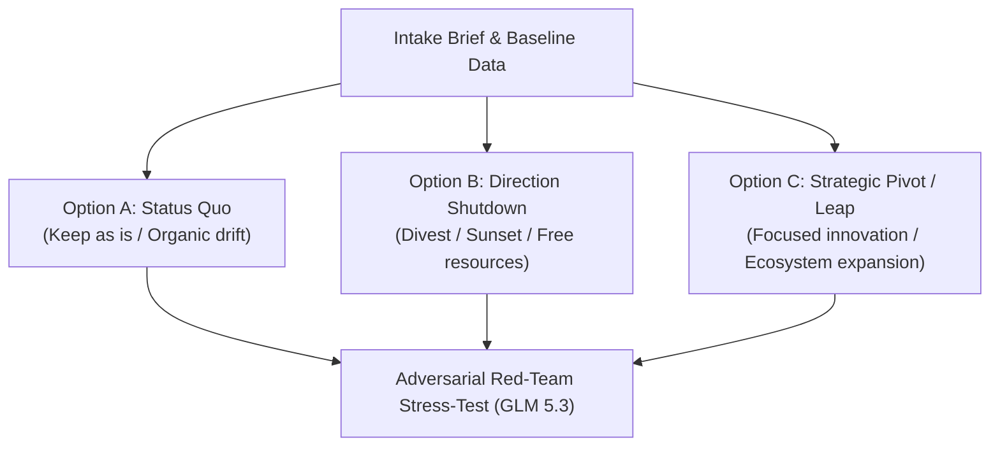
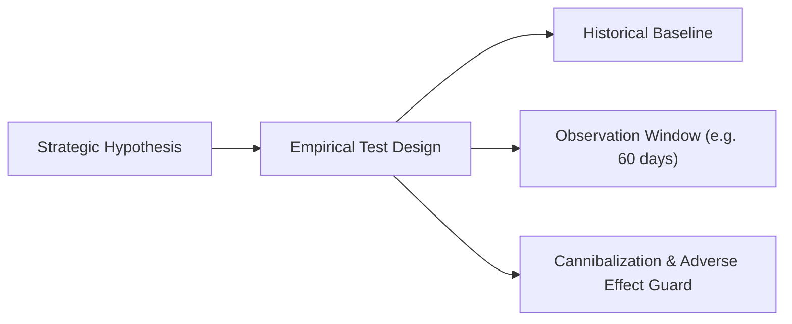

# Strategy Frameworks & Validation Standards

This document specifies the mandatory structures for strategic option generation, product strategy, communication strategy, and empirical validation plans.

---

## 1. Strategic Options Formulation: The Mandatory Triad

To counteract confirmation bias and managerial inertia, the agent must **always formulate at least three substantively distinct strategic choices**:

### Mandatory Requirements per Option:
1. **Value Proposition & Operational Thesis**: What changes for the user and the business?
2. **Economic Projections**: Gross profit delta, active subscriber forecast, capital and operational expenditure (CapEx / OpEx).
3. **Steelman Counterarguments**: The strongest possible objections, risks, and failure modes articulated with devil's advocacy.
4. **Epistemic Classification**: Explicit division into [FACT], [HYPOTHESIS], and [ASSUMPTION].

---

## 2. Product Strategy Architecture

The synthesized Product Strategy deliverable must contain four foundational pillars:

### Pillar 1: Audience & Jobs-to-be-Done (JTBD)
- Deep segmentation of the primary decision-maker ("Organizer / Head of Household") vs. secondary beneficiaries (children, elderly relatives, connected smart devices).
- Core emotional, functional, and social jobs.

### Pillar 2: Existing Alternatives & Unmet Needs
- What do customers currently do instead? (Separate individual SIMs across multiple operators, third-party IoT SIMs, Wi-Fi tethering).
- Why do existing solutions fail or create friction?

### Pillar 3: Chosen Vector & Conscious Refusals
- **Chosen Vector**: The unambiguous strategic focus (e.g., transforming a commodity multi-SIM discount into an integrated digital family safety & device ecosystem).
- **Conscious Refusals (What We Will NOT Do)**: Explicit boundary setting (e.g., "We will NOT enter an aggressive price-cutting war against budget MVNOs").

### Pillar 4: Value-to-Cost Economic Bridge
- Clear mathematical link between the value delivered to the household and the operator's cost structure.
- Unit economics: Customer Acquisition Cost (CAC), Average Revenue Per Account (ARPA), Lifetime Value (LTV), and Gross Margin contribution.

---

## 3. Communication Strategy Architecture

Promotional promises must strictly reflect authentic product reality. The Communication Strategy consists of four components:

### Component 1: Audience & Purchase / Usage Contexts
- Trigger moments: When does a family recognize the need to unite their mobile connectivity? (Child gets first smartphone, school year starts, elderly parent needs care).

### Component 2: Perception Barriers & Psychological Friction
- Key psychological hurdles (e.g., "Fear of losing control over personal number", "Complicated onboarding", "Reluctance to pay for others").

### Component 3: Core Message & Reason to Believe (RTB)
- **Key Message**: A singular, punchy proposition in plain Russian (`sasha` standard).
- **Reason to Believe (RTB)**: Tangible product proof points (e.g., "1 account, 0 surprise bills, auto-block of paid subscriptions, parental location alerts without extra app").

### Component 4: Channel Role Matrix
- Direct channels (Megafon App, SMS/Push, Retail stores, Call center).
- Digital acquisition (Contextual search, Family-oriented programmatic, Social communities).

---

## 4. Validation Plan Architecture

Every strategy must be experimentally verifiable before full capital commitment:

### Mandatory Components:
1. **Expected Metric Changes**: Target delta for primary KPI (e.g., active groups $+2,500$, monthly gross profit $+1.25$M ₽).
2. **Comparison Baseline**: Exact historical benchmark (e.g., Q3 baseline of 4,000 active groups).
3. **Observation Window**: Rigorously bounded timeframe (e.g., 8-week cohort observation).
4. **Adverse Effects & Cannibalization**: Guardrail metrics to ensure family plans do not cannibalize higher-margin standalone premium tariffs.

