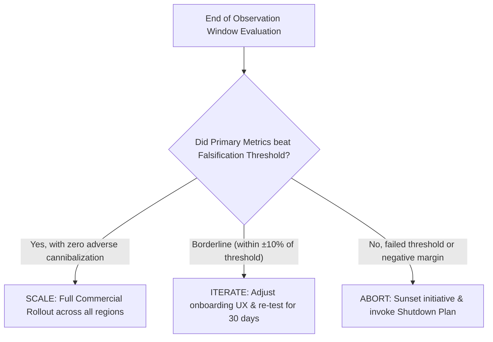

# Template: Validation Plan Deliverable

# Strategic Validation Plan: [Product Name / Strategic Initiative]

**Author**: Zakhar (Solo Maker)  
**Date**: [YYYY-MM-DD]  
**Project**: [Project Identifier]  
**Status**: [Draft | In Review | Ratified]  

---

## 1. Core Validation Hypotheses

| ID | Hypothesis Statement [HYPOTHESIS] | Expected Direction | Falsification Threshold |
| :--- | :--- | :--- | :--- |
| **H1** | [Specific behavioral or economic proposition] | [Metric delta $\ge +X\%$] | [Result $\le Y$ refutes hypothesis] |
| **H2** | [Secondary engagement or churn proposition] | [Churn reduction $\ge -Z$pp] | [Result $\le W$ refutes hypothesis] |

---

## 2. Test Architecture & Observation Protocol

- **Target Cohort**: [Exact cohort definition, sample size, geography].
- **Control Group**: [Clean baseline control cohort receiving standard service].
- **Observation Window**: [Explicit timeframe, e.g., 60 days / 8 weeks].
- **Comparison Baseline**: [Historical performance metrics prior to test launch].

---

## 3. Metrics Dashboard & Measurement Cadence

### 3.1 Primary Business Metrics (North Star)
- **Primary Metric 1**: [Metric name, baseline, target threshold, measurement source].
- **Primary Metric 2**: [Metric name, baseline, target threshold, measurement source].

### 3.2 Guardrail & Cannibalization Metrics (Adverse Effects)
- **Cannibalization Monitor**: [Tracking high-ARPU standalone subscribers to ensure net positive gross margin].
- **Support Ticket Volume**: [Monitoring onboarding confusion in customer support].

---

## 4. Managerial Decision Rules

