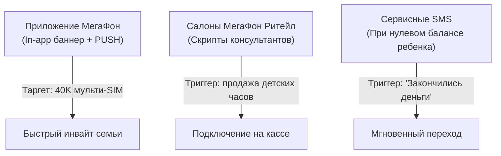

# Коммуникационная стратегия: «МегаФон Семья — Забота без лишних слов»

**Продукт**: «МегаФон Семья» (Фабрика продуктов МегаФона)  
**Автор**: Захар (Solo Maker)  
**Стандарт копирайтинга**: `sasha` (чистый, уважительный, лаконичный русский язык без рекламного мусора)  
**Статус**: Утверждена  

---

## 1. Коммуникационная цель и поведенческий сдвиг

- **Бизнес-цель**: Обеспечить конверсию 10% в подключение семейной группы среди базы владельцев 2+ SIM-карт (40 000 абонентов) и привлечь 2 000 семей через розничные салоны.
- **Поведенческий сдвиг**:
  - *Было*: «Каждый в семье сам следит за своим тарифом, я подключаюсь только когда у ребенка кончились деньги или списали лишнее».
  - *Стало*: «Я один раз объединяю номера семьи в приложении МегаФона, ставлю защиту от спама и больше не переживаю за баланс близких».

---

## 2. Ситуации контакта и триггеры спроса (Trigger Moments)

| Аудиторный сегмент | Ситуация-триггер (Момент потребности) | Барьер восприятия | Ключевое сообщение МегаФона |
| :--- | :--- | :--- | :--- |
| **Мама / Организатор семьи** | Покупка ребенку смартфона/часов в школу; списание денег за случайную подписку у бабушки. | «Семейный тариф — это сложно, придется куда-то идти с паспортами и вводить пароли». | **«Объедините номера семьи в приложении за минуту. Защита от платных подписок и спама включена».** |
| **Владелец мульти-SIM** | Внезапно перестал работать навигатор в планшете или трекер из-за нулевого баланса на второй SIM. | «Зачем мне семейный тариф, если я пользуюсь устройствами один?». | **«Все ваши SIM-карты и умные гаджеты на одном счете. Один баланс — ноль блокировок».** |
| **Пожилой родственник** | Звонки от неизвестных номеров, страх мошенников. | «Я не хочу, чтобы кто-то читал мои SMS или контролировал звонки». | **«Вы остаетесь на своем номере. Мы просто берем оплату на себя и глушим мошенников».** |

---

## 3. Архитектура смыслов: Сообщение и доказательства (RTB)

### 3.1 Главное сообщение (Key Message)
> **«Связь для тех, за кого вы отвечаете. Один счет, автозащита от спама и контроль без вторжения в личное пространство».**

### 3.2 Доказательная база (Reason to Believe — RTB)
1. **RTB 1 (Защита кошелька)**: Встроенный запрет платных мобильных подписок на уровне оператора — нулевой риск случайных списаний у детей и пожилых.
2. **RTB 2 (Бесшовный старт)**: Никаких походов в салон с чужими паспортами. Приглашение отправляется по защищенной ссылке прямо в мессенджер.
3. **RTB 3 (Честная прозрачность)**: Каждый участник сохраняет тайну связи (Глава семьи не видит личную детализацию чужих звонков, но видит остаток общего пакета).
4. **RTB 4 (Выгода в удержании)**: 500 рублей экономии на общем счете ежемесячно по сравнению с оплатой разрозненных тарифов.

---

## 4. Матрица каналов коммуникации (Omnichannel Matrix)

### Детализация каналов:

| Канал | Роль канала | Формат сообщения | Call-to-Action (CTA) |
| :--- | :--- | :--- | :--- |
| **Мобильное приложение** | Основной конверсионный хаб | Персональная карточка на главном экране для абонентов с $\ge 2$ SIM: *«У вас 2 активных номера. Объедините баланс и подключите автозащиту»*. | [Объединить за 1 минуту] |
| **Розница (Салоны связи)** | Точка входа для новых семей | Тейбл-тенты у касс + скрипт консультанта при продаже любых гаджетов: *«Настроим детские часы сразу с защитой от спама и привязкой к вашему номеру»*. | [Оформить семейный пакет] |
| **Триггерный CRM-контур** | Перехват момента стресса | SMS родителю при исчерпании пакета на номере ребенка: *«На номере +79XX закончились гигабайты. Подключите ребенка к своему пакету МегаФон Семья»*. | [Поделиться гигабайтами] |

---

## 5. Инвариант честности коммуникации (Promotional Invariant)
В соответствии со стандартом честности:
- **Запрещено** заявлять «Бесплатная связь для всей семьи» (вместо этого: *«Общий счет без переплат»*).
- **Запрещено** обещать «Тотальный трекинг переписок ребенка» (вместо этого: *«Геолокация и блокировка спама с сохранением личных границ»*).

