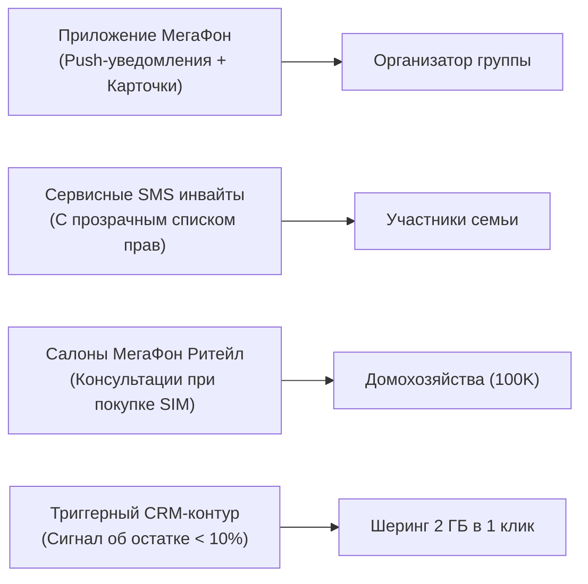

# Коммуникационная стратегия: «МегаФон Семья — Забота без лишних слов»

**Продукт**: Сервис семейной связи и мульти-SIM («МегаФон Семья»)  
**Заказчик**: Фабрика продуктов МегаФона  
**Конкурс**: MGIMO AI Challenge 2026 (Трек «Стратег Фабрики продуктов»)  
**Автор**: Захар (Solo Maker)  
**Стандарт копирайтинга**: `sasha` (чистый, лаконичный русский язык от первого лица, ориентированный на пользу и действия без рекламного шума)  
**Статус**: Утвержденная коммуникационная стратегия [APPROVED]  

---

## 1. Коммуникационная цель и поведенческий сдвиг

### 1.1 Бизнес-цель
Обеспечить привлечение и активацию **12 000 подключенных семейных групп** (включая **8 000 активных групп**) из доступной базы **100 000 домохозяйств** и **2 000 владельцев** из базы **40 000 пользователей мульти-SIM**, повысив долю активации созданных групп за 14 дней с **42% до 60%**.

### 1.2 Поведенческий сдвиг
- **Текущая модель («Реактивная паника»)**: Организатор узнает о перебое интернета у ребенка или пожилого родителя только постфактум — из тревожного звонка с просьбой о помощи, либо обнаруживает неожиданное списание при проверке баланса в конце месяца.
- **Целевая модель («Упреждающее спокойствие»)**: Организатор получает ненавязчивый push за 30–45 минут до исчерпания трафика у близкого и в одно касание добавляет 2 ГБ из свободного остатка общего семейного пакета. Близкий защищен, связь не прерывается, нет стресса и выяснения причин.

---

## 2. Ситуации контакта, барьеры и ключевые сообщения

| Аудиторный сегмент | Ситуация контакта (Trigger Moment) | Барьер восприятия клиента | Ключевое сообщение МегаФона (Key Message) | Доказательство истинности (Reason to Believe) |
| :--- | :--- | :--- | :--- | :--- |
| **Организатор группы (Глава семьи)** | Ребенок идет из школы, родитель замечает, что геолокация или мессенджер ребенка перестали обновляться. | *«Семейный тариф — это обуза. Я запутаюсь в списаниях, а если что-то пойдет не так, связь отключится у всех»*. | **«Связь близких под контролем без лишних списаний. Мы заранее предупредим о низком остатке и поможем добавить трафик в 1 клик».** | Упреждающий push при остатке $<10\%$ общего пакета. Кнопка «Добавить 2 ГБ из свободного остатка» прямо в пуше. |
| **Участник группы (Близкий, подросток)** | Получение SMS-приглашения в семейную группу от родителя. | *«Родители будут шпионить за моими звонками, сайтами и расходами»*. | **«Вы остаетесь на своем номере с полной приватностью. Семья видит только остаток трафика, чтобы вовремя помочь».** | Строгая изоляция прав: согласие на остаток интернета НЕ открывает доступ к начислениям, балансу счета и детализации звонков. |
| **Пожилой родственник (Родители 60+)** | Звонки от неизвестных номеров, страх случайно нажать платную кнопку или остаться с нулевым балансом. | *«Я боюсь что-то сломать или подключить платную услугу, с которой спишут пенсию»*. | **«Вы всегда на связи с родными. Заботу об оплате и пакете интернета берут на себя близкие».** | Автоматическое уведомление организатора при угрозе неоплаты за 2 дня до списания. Нулевой риск блокировки номера. |
| **Владелец нескольких номеров (мульти-SIM)** | Умный роутер на даче или смарт-часы внезапно прекратили раздачу из-за исчерпания трафика на второй SIM. | *«Зачем мне семейный тариф, если я пользуюсь второй картой один в роутере?»*. | **«Одна общая квота интернета на смартфон и ваши устройства. Роутер не отключится в разгар работы».** | Привязка второй SIM к единому пулу без абонентской платы за отдельный тариф. Мониторинг статуса связи в приложении. |

---

## 3. Архитектура смыслов и Reason to Believe (RTB)

### 3.1 Главное коммуникационное сообщение (Core Key Message)
> **«Связь для близких без перебоев и стресса: общий запас интернета, предупреждение за шаг до блокировки и мгновенная помощь в одно касание».**

### 3.2 Доказательная база (Reason to Believe — RTB)
1. **RTB-1 (Упреждение вместо ликвидации)**: Система мониторинга биллинга присылает уведомление при снижении остатка до 10% или 800 МБ. Вы помогаете близкому до того, как связь оборвется.
2. **RTB-2 (Одно действие)**: Добавление гигабайтов происходит прямо из всплывающего уведомления или главного экрана приложения за 3 секунды. Никаких USSD-команд, входа по SMS-паролям и звонков в контактный центр.
3. **RTB-3 (Честная приватность)**: МегаФон гарантирует раздельные согласия. Разрешение видеть остаток трафика защищено криптографически и не открывает доступ к финансовым начислениям и личным выпискам.
4. **RTB-4 (Прозрачная экономия)**: Каждый сохраненный месяц непрерывного обслуживания окупает объединение номеров, а оператор экономит ваше время на разбор спорных списаний.

---

## 4. Матрица каналов коммуникации (Omnichannel Matrix)

### Детализация коммуникационных форматов:
- **Push-уведомление организатору (Триггер: остаток <10%)**:
  > *«У мамы на номере +7 (926) ... осталось 800 МБ. Добавить 2 ГБ из вашего семейного пакета?»*  
  > Кнопки действия: `[Добавить 2 ГБ]` / `[Напомнить позже]`.
- **SMS участнику при получении инвайта**:
  > *«Организатор приглашает вас в группу МегаФон Семья. Вы получите доступ к общему интернету. Организатор сможет видеть только остаток гигабайтов. Ваши звонки и баланс останутся скрытыми. Подтвердить: megafon.ru/f/XXXXX или ответьте ДА»*.
- **Сервисное уведомление участнику при выделении пакета**:
  > *«Вам добавлено 2 ГБ из семейного запаса. Остаток пакета: 2.8 ГБ. Приятного общения!»*.

---

## 5. Инвариант честности коммуникации (Ethical & Truthful Guardrails)
В строгом соответствии с конкурсными правилами и политикой прозрачности МегаФона:
1. **Запрещены скрытые маркетинговые звездочки**: Все условия списания из общего пула и лимиты отображаются крупным контрастным шрифтом на экране подтверждения.
2. **Запрещено заявлять «Бесплатный безлимитный интернет»**: Коммуникация четко объясняет, что участники делят оплаченный объем семейного пакета организатора.
3. **Строгое соответствие функционалу**: Коммуникация обещает только те возможности, которые гарантированно реализованы в текущей версии биллинга (перевод свободного остатка и упреждающий пуш). Никаких нереалистичных обещаний «тотального родительского контроля переписок».
