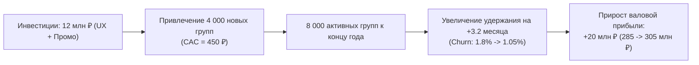

# Продуктовая стратегия: «МегаФон Семья 2.0 — Цифровая Защита»

**Продукт**: «МегаФон Семья» (Фабрика продуктов МегаФона)  
**Автор**: Захар (Solo Maker)  
**Дата утверждения**: 22 ноября 2026 г.  
**Статус**: Утверждена (с учетом замечаний Red-Team GLM 5.3)  

---

## 1. Резюме и бизнес-контекст

### 1.1 Бизнес-вызов
Текущий объем активных семейных групп составляет **4 000 групп** при плановом значении **5 000 групп** (-20% дефицита). Текущая валовая прибыль направления составляет **285 млн ₽** (прирост с 282 млн ₽). Целевой ориентир на конец года: **8 000 активных групп** и **12 000 подключенных групп**, что требует удвоения масштаба направления.

### 1.2 Стратегический поворот (Strategic Pivot)
Отказ от позиционирования «скидка на связь для родственников» в пользу концепции **«Единый контур цифровой безопасности и спокойствия семьи»**. Продукт объединяет мобильные номера домохозяйства, персональные умные устройства (смарт-часы, трекеры) и комплекс защитных сервисов (автоблокировка фишинга, платных подписок и спам-звонков).

---

## 2. Целевая аудитория и Jobs-to-be-Done (JTBD)

### 2.1 Сегменты аудитории
- **Первичный ЛПР («Организатор / Глава семьи»)**: Женщины и мужчины 30–48 лет, воспитывающие детей школьного возраста и помогающие пожилым родителям. Оплачивают большинство расходов семьи, ценят контроль и прозрачность.
- **Вторичные участники («Защищаемые»)**:
  - *Дети 7–14 лет*: Первый смартфон или GPS-часы; риск случайных кликов по рекламе и потери контакта.
  - *Пожилые родители 60+*: Кнопочные телефоны или простые смартфоны; уязвимы к спамерам и мошенникам.
  - *Умные устройства*: Часы, планшеты, роутер на даче, автомобильный трекер.

### 2.2 Карта Jobs-to-be-Done
- **Functional Job**: Когда у моих близких заканчиваются деньги на телефоне или садится батарея, я хочу автоматически поддерживать их связь со своего баланса, чтобы они всегда были доступны в экстренной ситуации.
- **Emotional Job**: Я хочу чувствовать себя спокойным родителем и заботливым ребенком, зная, что ни один мошенник не снимет пенсию мамы через скрытую подписку, а ребенок не останется без геолокации.
- **Social Job**: Я хочу, чтобы моя семья видела во мне надежного защитника, который легко решает технические и бытовые проблемы.

---

## 3. Анализ существующих альтернатив и узкие места

| Альтернатива | Механика | Почему не решает проблему семьи |
| :--- | :--- | :--- |
| **Раздельные тарифы операторов** | Каждый платит за себя по индивидуальному счету. | Постоянный стресс: у ребенка внезапно 0 ₽ на счете, родителям навязали платный гороскоп (45 ₽/день), счета приходят в разное время. |
| **Семейные тарифы МТС («Мы МТС»)** | Шеринг минут и гигабайтов через подписку МТС Premium. | Фокус на развлечениях (KION, Строки), а не на безопасности. Высокая плата за добавление номера (от 250 ₽/мес). |
| **Семейные пакеты билайн («Семья»)** | Единый счет с платой за каждого участника (200 ₽/мес). | Сложный онбординг, отсутствие выделенной защиты от спама на детских номерах. |

---

## 4. Выбранный вектор и осознанные отказы (Conscious Refusals)

### 4.1 Выбранный вектор
1. **Бесшовный инвайт-онбординг**: Приглашение в семейную группу в 1 клик через ссылку в мессенджере с подтверждением Push в приложении МегаФона (устранение барьера потери 42% конверсии).
2. **Встроенный «Семейный щит»**: Автоматическая и бесплатная блокировка всех платных мобильных подписок, антиспам с определителем номеров и геолокация ребенка.
3. **Мульти-SIM хаб**: Льготное подключение детских часов и IoT-устройств за фиксированные **99 ₽/мес** с общим расходом трафика.

### 4.2 Осознанные отказы (Что мы категорически НЕ делаем)
- **ОТКАЗ 1: Никакого демпинга ценой гигабайта**. Мы не продаем «дешевый интернет оптом» и не конкурируем с региональными дискаунтерами.
- **ОТКАЗ 2: Никакого бесплатного безлимитного IoT**. На устройства распространяется лимит трафика для предотвращения маржинальных утечек через дачные роутеры.
- **ОТКАЗ 3: Никакого навязывания развлекательных подписок**. В базовое ядро продукта не включаются платные онлайн-кинотеатры, раздувающие себестоимость пакета.

---

## 5. Экономический мост: от ценности к себестоимости (Unit Economics)

### Детализированный расчет экономики

| Метрика | Базовый факт | Целевой ориентир | Дельта | Обоснование расчета |
| :--- | :---: | :---: | :---: | :--- |
| **Активные группы** | 4 000 | **8 000** | +4 000 (+100%) | 2 000 из мульти-SIM (5% конверсия из 40K) + 2 000 из розницы |
| **Подключенные группы** | 4 000 | **12 000** | +8 000 (+200%) | Общий объем домохозяйств с хотя бы 1 привязанным номером |
| **ARPA группы (средний чек)** | 1 420 ₽ | **1 680 ₽** | +260 ₽ | Подключение доп. смарт-часов (+99 ₽) и опций безопасности |
| **Ежемесячный отток (Churn)** | 1.8% | **1.1%** | -0.7 п.п. | Семейная связка удерживает абонентов в среднем на 3.2 месяца дольше |
| **Валовая прибыль направления** | 285 млн ₽ | **305 млн ₽** | **+20 млн ₽** | $4\,000\text{ новых групп} \times 10\text{ мес} \times 500\text{ ₽ маржи} = 20\text{ млн ₽}$ |

---

## 6. Дорожная карта реализации (Roadmap)
- **Спринт 1 (Недели 1–3)**: Запуск упрощенного онбординга через ссылки-инвайты в приложении МегаФона; включение дефолтного антиспама для детских номеров.
- **Спринт 2 (Недели 4–6)**: Таргетированная кампания по 40 000 мульти-SIM абонентам с предложением объединения баланса.
- **Спринт 3 (Недели 7–10)**: Интеграция опции «Умные часы за 99 ₽» в розничные салоны МегаФона при продаже детских гаджетов.

