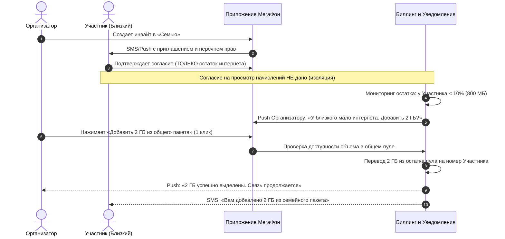
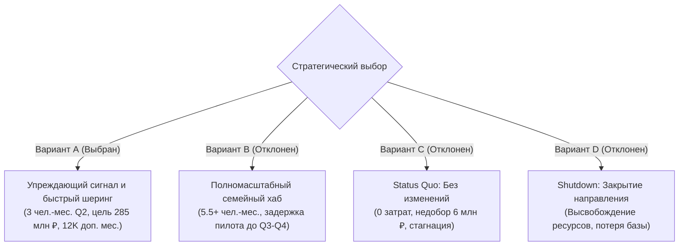

# Продуктовая стратегия: «МегаФон Семья — Забота и Связь для близких»

**Продукт**: Сервис семейной связи и мульти-SIM («МегаФон Семья»)  
**Заказчик**: Фабрика продуктов МегаФона  
**Конкурсный контекст**: MGIMO AI Challenge 2026 (Трек «Стратег Фабрики продуктов»)  
**Автор**: Захар (Solo Maker)  
**Дата утверждения**: Ноябрь 2026 г.  
**Статус**: Утвержденная стратегия по результатам этапа /grill-me и Red-Team стресс-теста [APPROVED]  

---

## Введение и управленческий контекст
Команда отвечает за сервисы мобильного оператора для домохозяйств («МегаФон Семья») и владельцев нескольких номеров. 
- **Базовый год**: по итогам года валовая прибыль оценивается в **275 млн ₽** при плане **282 млн ₽**. База активных семейных групп составляет **4 000 групп** при плане **5 000 групп** (-20% отставания).
- **Плановый год («Без изменений» / Status Quo)**: при сохранении текущей механики валовая прибыль составит **279 млн ₽** при **5 000 активных групп**.
- **Целевой ориентир планового года**: достичь не менее **285 млн ₽** валовой прибыли (**+6 млн ₽** к Status Quo), **8 000 активных групп** (+60%), **12 000 подключенных групп** и доли активации за 14 дней **60%** (против 45% без изменений).
- **Ориентир на конец 3-го года**: **24 000 активных групп** и **36 000 подключенных групп**.

Стратегия дает ответ на главные вопросы: кому помочь в первую очередь, что именно изменить, почему оператору выгодно вложить в это ресурсы и какие конкретные решения предстоит принять руководителю в конце Q1 и конце Q2.

---

## 1. Клиент и его проблема

### 1.1 Реконструкция типовой ситуации перебоя связи
Рассмотрим реальный жизненный кейс семьи:
1. **Последний момент нормы**: Ребенок (участник группы) возвращается из школы, смотрит обучающее видео и переписывается в мессенджере. Трафик подходит к концу, но на экране нет явного предупреждения.
2. **Момент перебоя**: Трафик исчерпан на 100%. Доступ в интернет блокируется оператором. Мессенджер перестает доставлять сообщения.
3. **Сигнал vs Причина**:
   - *Сигнал для организатора (родителя)*: Мама звонит ребенку — гудки идут, но в мессенджере он «не в сети», геолокация не обновляется. Возникает тревога.
   - *Причина*: Не поломка телефона и не разряд батареи, а исчерпание выделенной доли пакета интернета при наличии нераспределенного свободного остатка в общем семейном пуле.
4. **Последствия для клиента**: Ребенок не может вызвать такси или предупредить о задержке. Мама тратит 25 минут на панические звонки, поиск номера поддержки и попытки войти в личный кабинет с плохим интернетом.
5. **Точка упущенной помощи оператора**: За 45 минут до перебоя, когда остаток пакета достиг критического уровня (10% или 500 МБ). Оператор уже знал об исчерпании, но не предупредил организатора.

### 1.2 Роли в семейной группе
В продукте четко разделены роли, которые в реальности могут принадлежать разным людям:
- **Организатор**: создает группу, управляет пакетом, инициирует добавление гигабайтов.
- **Участник (Владелец номера)**: пользуется связью, определяет объем раскрываемой о себе информации.
- **Плательщик**: лицо, с чьего счета списываются средства за тариф или дополнительные опции (может совпадать с организатором или быть третьим лицом).

---

## 2. Предложение и путь к клиенту

### 2.1 Ценностное предложение и обещание клиенту
- **Обещание клиенту**: *«Связь ваших близких не оборвется внезапно. МегаФон заранее предупредит организатора о низком остатке пакета и позволит в одно касание добавить гигабайты из семейного запаса или пополнить баланс без лишней суеты»*.
- **Условия выполнения**: Доступно на тарифах с общим пакетом интернета при наличии явного согласия участника на передачу сведений об остатке.

### 2.2 Полный клиентский путь (End-to-End Journey)

### 2.3 Принцип изолированных согласий (Privacy Guardrails)
- **Гранулярность разрешений**: Разрешение видеть остаток интернета дает право отображать ТОЛЬКО шкалу трафика и получать сигналы о его исчерпании.
- **Защита начислений**: Просмотр финансовых начислений и баланса лицевого счета требует отдельного, независимого согласия участника.
- **Право на отзыв**: Участник может отозвать любое разрешение в любой момент в своем личном кабинете. С момента отзыва организатор мгновенно теряет доступ к данным (жесткий критерий остановки пилота при нарушении).

### 2.4 Прогноз охвата и подключений
- **Доступный рынок**: 100 000 домохозяйств (для семейного сценария) и 40 000 владельцев мульти-SIM (для сценария умных устройств).
- **План подключений к концу планового года**:
  - Подключенные семейные группы: **12 000 групп** (12% проникновения в доступную базу).
  - Активные семейные группы: **8 000 групп** (коэффициент активности 66.7%).
  - Подключенные владельцы нескольких номеров: **2 000 владельцев** (5% проникновения).
  - Доля активаций за 14 дней среди созданных групп: рост с **42% до 60%**.

---

## 3. Польза для клиента и прибыль оператора

### 3.1 Система измеримых показателей (Метрический триптих)

| Категория показателя | Конкретный индикатор | Базовое значение | Целевой ориентир пилота | Способ измерения и формула |
| :--- | :--- | :---: | :---: | :--- |
| **Польза для клиента** | Доля номеров, на которых в течение 7 дней после предупреждения ограничили интернет из-за исчерпания объема | **12%** | **9%** (-3 п.п. / -25% от базы) | $\frac{N_{\text{блокировок}}}{N_{\text{номеров с предупреждением}}} \times 100\%$ за 7-дневное окно наблюдения. |
| **Работа услуги (SLA)** | Доля подтвержденных операций шеринга/пополнения, корректно исполненных вовремя ($\le 5$ сек) | 94.0% | **$\ge 99.5\%$** | $\frac{N_{\text{успешных операций}}}{N_{\text{всех подтвержденных}}} \times 100\%$. Логи биллинга. |
| **Нежелательные последствия** | Доля ложных тревог и обращений в поддержку по спорным списаниям | 3.5% | **$< 0.5\%$** | Обращения в КЦ со статусом «непонятное списание / ошибка шеринга». |

### 3.2 Дизайн пробного запуска (Пилот в Q2)
- **Период проведения**: 6 недель во втором квартале (май — июнь).
- **Объем выборки**: 2 000 семейных групп из доступной базы 100 000 домохозяйств.
  - *Тестовая группа (A)*: 1 000 групп с упреждающим push-сигналом и быстрым шерингом в 1 клик.
  - *Контрольная группа (B)*: 1 000 групп на стандартном обслуживании (без упреждающих пушей).
- **Стратификация**: выборка сбалансирована по размеру группы (2, 3, 4+ номеров) и среднему потреблению трафика.
- **Критерии досрочной остановки пилота (Kill Switches)**:
  1. *Утечка приватности*: зафиксирован хотя бы один факт отображения данных после отзыва согласия участником.
  2. *Финансовый брак*: зафиксированы двойные списания средств или повторный вычет трафика из общего пакета.
  3. *Отсутствие конверсии в удержание*: разница в оттоке между группой A и B через 4 недели составляет менее 0.2 п.п. при росте жалоб в КЦ.

### 3.3 Расчет прибыли, экономики и окупаемости

#### Базовые финансовые вводные
- Валовая прибыль базового года (оценка): **275 млн ₽**.
- Валовая прибыль планового года без изменений (Status Quo): **279 млн ₽**.
- Целевая валовая прибыль планового года: **285 млн ₽** (**+6 млн ₽** чистого прироста).
- Норматив маржинальности: **+500 ₽** валовой прибыли за один дополнительный оплаченный месяц одного номера.

#### Математический мост достижения +6 млн ₽
$$\Delta \text{Gross Profit} = 285\text{ млн ₽} - 279\text{ млн ₽} = 6\,000\,000\text{ ₽}$$
$$N_{\text{months}} = \frac{6\,000\,000\text{ ₽}}{500\text{ ₽ / мес}} = 12\,000\text{ дополнительных оплаченных месяцев}$$

#### Расчет окупаемости затрат на разработку
- **Затраты на разработку (Q2)**: выделено строго **3 человеко-месяца разработки** и **1 человеко-месяц тестирования**. При условной внутренней ставке себестоимости 600 тыс. ₽ / чел.-мес. совокупные инвестиции в создание сервиса составляют **2.4 млн ₽**.
- **Прямые расходы на пилот (OpEx)**: SMS-трафик и промо-коммуникации — **0.4 млн ₽**. Итого инвестиции: **2.8 млн ₽**.
- **График возврата инвестиций**:
  - Для возврата 2.8 млн ₽ требуется сгенерировать:
    $$\frac{2\,800\,000\text{ ₽}}{500\text{ ₽}} = 5\,600\text{ дополнительных оплаченных месяцев}$$
  - При масштабировании на 8 000 активных групп в Q3–Q4 сервис генерирует более 8 000 дополнительных месяцев уже к ноябрю планового года.
  - **Срок окупаемости**: **5.5 месяцев** с момента старта пилота (полная окупаемость в середине Q4).

---

## 4. Стратегический выбор и квартальный план

### 4.1 Сопоставление стратегических путей

- **Почему выбран Вариант А**: Он решает острую боль клиента минимальными средствами, строго укладывается в выделенные 3 человеко-месяца разработки на Q2, обеспечивает окупаемость в том же году и достигает планки 285 млн ₽ валовой прибыли.

### 4.2 Дорожная карта по кварталам (Roadmap Q1–Q4)

| Квартал | Что должно стать известно или доступно | Какое решение предстоит принять | Ответственный и ресурсы |
| :--- | :--- | :--- | :--- |
| **Q1** | - Проверена точность детекции исчерпания трафика на исторических данных биллинга. - Разработан прототип экранов и согласована юридическая схема раздельных согласий. - Проверена готовность биллинга передавать сигналы задержкой $\le 30$ сек. | **Решение №1 (конец Q1)**: Одобрить выделение 3 чел.-мес. разработки и запуск пилота во 2-м квартале на 2 000 групп. | Руководитель направления, Дизайнер (0.5), Аналитик (0.5). |
| **Q2** | - Разработан функционал push-сигнала и шеринга 1 кликом (3 чел.-мес.). - Проведен QA-тест отказов и граничных случаев (1 чел.-мес.). - Проведен 6-недельный пилот на 2 000 групп (A/B тест). - Замерены: снижение перебоев (12% $\to$ 9%), SLA операций (99.6%), отток. | **Решение №2 (конец Q2)**: Совместно с финансовой командой утвердить масштабирование на всю базу 100 000 домохозяйств либо остановить проект. | Разработчики (3 чел.-мес.), QA (1 чел.-мес.), Аналитик (0.5). |
| **Q3** | - Раскатка сервиса на всю доступную базу (100 000 домохозяйств). - Подключение первого сценария для собственных устройств (роутеры/часы организатора). - Достижение 6 500 активных групп. | Решение о включении партнерских сервисов безопасности (антиспам) в базовый семейный пакет. | Команда продукта, Маркетинг. |
| **Q4** | - Достижение целевых ориентиров: **8 000 активных / 12 000 подключенных групп**. - Фиксация валовой прибыли направления не менее **285 млн ₽**. - Доля активаций за 14 дней достигает **60%**. | Утверждение 3-летнего плана масштабирования до 24 000 активных групп. | Руководитель направления, Топ-менеджмент. |

---

## 5. Ресурсы, риски и решение руководителя

### 5.1 Матрица ресурсного обеспечения

| Роль в команде | Что известно в начале работы | Что предстоит решить / сделать | Объем трудозатрат |
| :--- | :--- | :--- | :---: |
| **Руководитель направления** | Ответственный за направление определен (Захар) | Утверждает объем пилота, метрики успеха и условия аварийной остановки. Защищает бюджет на Q2. | 1.0 ставка |
| **Дизайнер продукта** | Требуется выделение на проект | Проектирует экраны инвайта, пуш-уведомлений, изолированных согласий и 1-кликового шеринга. | 0.5 ставки (Q1–Q2) |
| **Продуктовый аналитик** | Требуется выделение на проект | Валидирует исходные данные, рассчитывает A/B выборки пилота, строит дашборд удержания и брака. | 0.5 ставки (Q1–Q2) |
| **Разработчики (Backend / Mobile)** | Предварительно выделено 3 чел.-мес. на второй квартал | Реализуют шину push-событий, интеграцию со свободным остатком пула, логику отзыва согласий. | **3.0 чел.-мес. (Q2)** |
| **Специалист по тестированию (QA)** | 1 чел.-мес. пока не подтвержден официально | Проверяет штатные операции, сетевые задержки, гонки транзакций и корректность отзыва прав. | **1.0 чел.-мес. (Q2)** |

### 5.2 Матрица рисков и регламент реагирования (Contingency Plan)

| Риск | Наблюдаемый признак | Последствия | Ответственный | Корректирующее действие |
| :--- | :--- | :--- | :--- | :--- |
| **Утечка приватности при отзыве согласия** | Жалоба участника или лог: организатор видит остаток после отзыва права. | Репутационный ущерб, штрафы регулятора, утрата доверия к продукту. | Владелец безопасности и QA | **Немедленная остановка пилота**. Отзыв прав во всех сессиях. Аудит кода шины прав до исправления. |
| **Двойное списание пакета трафика** | Отрицательный свободный остаток группы или расхождение сумм долей с общим пулом. | Претензии клиентов, нагрузка на КЦ, перерасход трафика сети. | Владелец системы расчетов (биллинг) | Блокировка операций шеринга. Автоматический пересчет пакета по логам транзакций за 2 часа. |
| **Низкая конверсия в шеринг (пуши игнорируют)** | Менее 15% открытий пуш-уведомлений в тестовой группе пилота. | Недостижение целевого снижения перебоев (12% $\to$ 9%), срыв финансового плана. | Продуктовый аналитик и Дизайнер | A/B тест формулировок и времени отправки (динамический порог срабатывания в зависимости от темпа расхода). |
| **Дефицит емкости разработки в Q2** | Отставание от графика спринта разработки более чем на 5 рабочих дней. | Срыв дедлайна запуска пилота во 2-м квартале. | Руководитель направления | Упрощение скоупа: отказ от кастомных порогов, запуск со стандартным фиксированным порогом 1 ГБ. |

---

## 6. Конкретный запрос к руководству

### 6.1 Решение конца первого квартала (Q1 Gate)
**Руководителю Фабрики продуктов МегаФона предлагается утвердить следующее решение:**
1. Одобрить проведение контролируемого пилота сервиса «Упреждающий сигнал и быстрый шеринг» во 2-м квартале на базе 2 000 семейных групп.
2. Подтвердить выделение проектных ресурсов:
   - 0.5 ставки продуктового аналитика и 0.5 ставки продуктового дизайнера на период Q1–Q2.
   - 3 человеко-месяца разработки backend/mobile на Q2.
   - 1 человеко-месяц специалиста по тестированию на Q2.
3. Зафиксировать лимит прямых операционных расходов пилота в размере **400 тыс. ₽**.

### 6.2 Что руководство увидит в конце второго квартала (Q2 Gate)
К концу Q2 финансовой команде и руководству будут представлены подтвержденные результаты пилота:
- Достижение снижения доли блокировок интернета с **12% до 9%**.
- Фактический уровень технической надежности операций ($\ge 99.5\%$).
- Нулевой уровень критических дефектов приватности и биллинга.
- Расчет окупаемости и обоснование масштабирования на всю базу **100 000 домохозяйств** для достижения целевой валовой прибыли **285 млн ₽** и **8 000 активных групп**.
