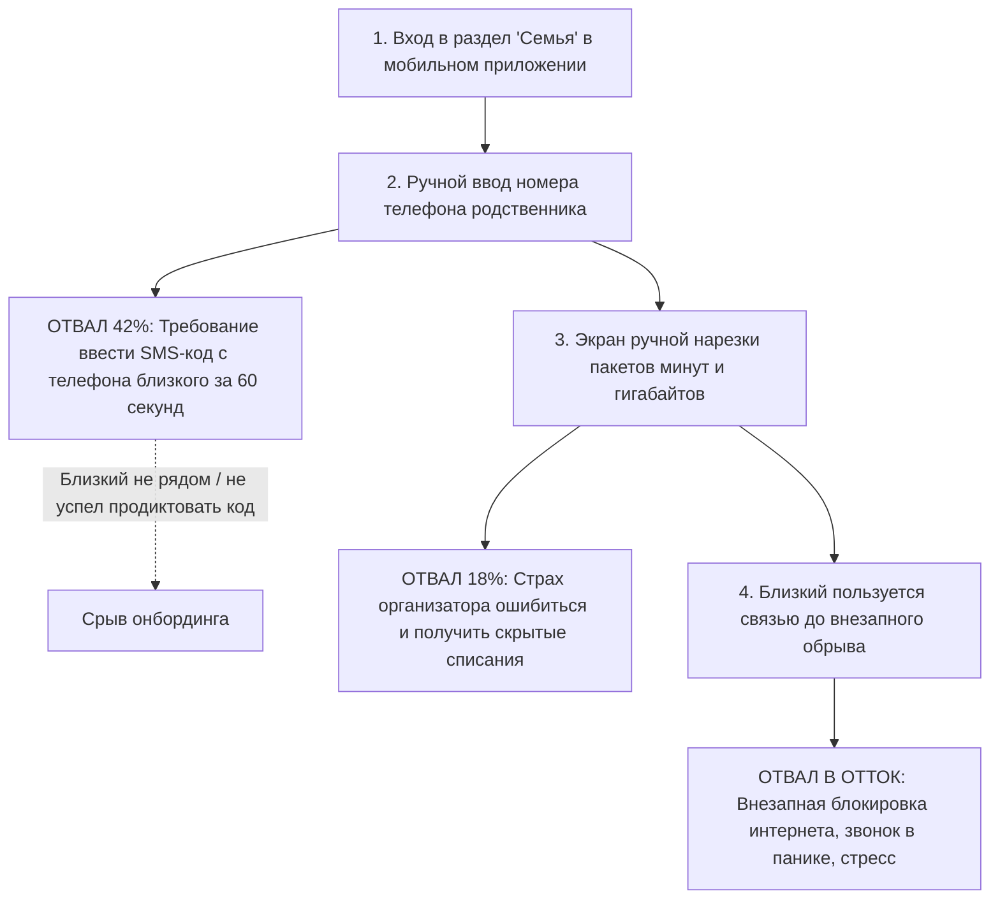
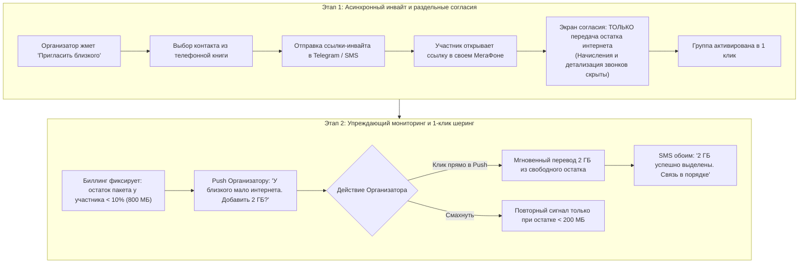

# UX & Customer Journey Analysis: «МегаФон Семья»

**Продукт**: Сервис семейной связи и мульти-SIM («МегаФон Семья»)  
**Заказчик**: Фабрика продуктов МегаФона  
**Конкурсный трек**: MGIMO AI Challenge 2026 («Стратег Фабрики продуктов»)  
**Автор**: Захар (Solo Maker)  
**Стандарт проектирования**: `better-interface` & `sasha` (чистый B2B/B2C интерфейс, однозначные действия, защита приватности, отсутствие визуального мусора)  
**Статус**: Утвержденная спецификация пользовательских путей [APPROVED]  

---

## 1. Сравнительный анализ: Текущий путь (As-Is) vs Целевой путь (To-Be)

### 1.1 Текущий путь (As-Is) и ключевые барьеры

**Критические дефекты As-Is**:
1. *Синхронный SMS-барьер*: принуждение организатора физически находиться рядом с участником или вызванивать его для диктовки кода подтверждения.
2. *Смешение прав*: участник не понимает, получит ли организатор доступ к детализации звонков, SMS и финансовым начислениям.
3. *Реактивность*: оператор блокирует трафик молча, не предлагая спасительного действия до наступления перебоя.

---

### 1.2 Целевой путь (To-Be): Легкий инвайт и упреждающий шеринг

---

## 2. Пошаговые сценарии ключевых ролей (Role-Based Flows)

### Сценарий 1: Роль Организатора (Глава семьи)
1. **Экран управления группой**:
   - Отображается общий семейный пирог гигабайтов: *«Свободно в семье: 24 ГБ из 40 ГБ»*.
   - Список карточек участников с цветовой индикацией:
     - Зеленый индикатор: запас интернета $>30\%$.
     - Желтый индикатор: остаток $<10\%$ (ситуация внимания).
     - Красный индикатор: угроза блокировки (нулевой баланс или $<1$ ГБ).
2. **Получение упреждающего Push-уведомления**:
   - Текст уведомления: *«У мамы на номере +7 (926) ... осталось 800 МБ. Добавить 2 ГБ из свободного остатка семьи?»*.
   - Интерактивные кнопки прямо в шторке уведомлений iOS/Android:
     - `[Добавить 2 ГБ]` — исполнение за 3 секунды без открытия приложения.
     - `[Открыть приложение]` — переход к детальному экрану группы.
3. **Обработка нехватки свободного остатка**:
   - Если свободный пул семьи исчерпан, кнопка автоматически меняется на `[Пополнить счет на 200 ₽]` с возможностью оплаты через СБП / привязанную карту в 1 клик.

---

### Сценарий 2: Роль Участника (Близкий, подросток или родитель)
1. **Получение приглашения в группу**:
   - Поступает системное SMS или Push-уведомление от имени МегаФона:
     > *«Организатор (+7 926 XXX-XX-XX) приглашает вас в семейную группу. Вы сможете пользоваться общим интернетом. Ваши начисления, баланс и история звонков останутся полностью конфиденциальными»*.
2. **Экран подтверждения согласий (Consent Screen)**:
   - Два независимых чекбокса (по умолчанию активен только первый):
     - `[x]` *Разрешить организатору видеть остаток гигабайтов и вовремя пополнять пакет* (Обязательно для шеринга).
     - `[ ]` *Разрешить просмотр начислений и оплату услуг* (Опционально, по умолчанию выключено).
   - Кнопка: `[Принять приглашение]`.
3. **Экран управления приватностью и отзыв согласия (Revoke Permission)**:
   - В профиле участника всегда доступен пункт: *«Мое участие в семье»*.
   - Кнопка: `[Отозвать согласие на просмотр остатка]`.
   - При нажатии: мгновенный отзыв прав, организатор видит заглушку *«Участник скрыл сведения об остатке»*, любые упреждающие пуши немедленно прекращаются.

---

### Сценарий 3: Роль Плательщика (Финансовый контур)
- В 75% случаев совпадает с Организатором. В случаях, когда плательщиком выступает другой человек (например, взрослый работающий сын оплачивает тариф пожилых родителей, но организатором группы в приложении является мама):
  - Плательщик получает пуш строго о предстоящем регулярном платеже за 3 дня: *«25 мая будет списана абонентская плата 1 450 ₽ за тариф МегаФон Семья. Баланс достаточен (+1 800 ₽)»*.
  - Плательщик не отвлекается на мелкие операционные сигналы о шеринге гигабайтов между родителями.

---

### Сценарий 4: Собственные устройства (Мульти-SIM роутер / Умные часы)
1. **Отображение в списке устройств**:
   - Вкладка *«Мои устройства»* внутри раздела семьи.
   - Умный дачный роутер отображается отдельной карточкой: номер SIM, статус сети (Online/Offline) и текущий расход трафика.
2. **Упреждение перебоя домашнего интернета**:
   - Пуш организатору за 48 часов до списания или при расходе 90% лимита роутера:
     > *«На дачном роутере заканчивается интернет (осталось 3 ГБ). Выделить 10 ГБ из семейного запаса?»*.
   - Кнопка: `[Выделить 10 ГБ]`. Дачный интернет продолжает работать без отключения систем видеонаблюдения и котла.

---

## 3. Требования к отказоустойчивости и краевым ситуациям (Edge Cases)

| Краевая ситуация (Edge Case) | Поведение системы | Интерфейсное сообщение для пользователя |
| :--- | :--- | :--- |
| **Участник нажал «Отклонить инвайт»** | Инвайт аннулируется, статус в кабинете организатора меняется на «Отклонено». | Организатору: *«Участник отклонил приглашение. Вы можете отправить новую ссылку позже»*. |
| **В общем семейном пуле 0 ГБ свободного остатка** | Кнопка «Добавить из остатка» деактивируется, предлагается быстрое пополнение пакета. | Организатору: *«В семейном пакете не осталось свободных гигабайтов. Докупить 5 ГБ за 199 ₽?»*. |
| **Сетевой сбой при отправке пуша** | Повтор попытки через резервный SMS-шлюз через 5 минут при сохранении критического остатка. | SMS организатору: *«У близкого на номере +79XX осталось 500 МБ. Добавьте гигабайты в приложении»*. |
| **Участник вышел из семейной группы** | Немедленный возврат на индивидуальный тариф без потери связи. | Участнику: *«Вы вышли из семейной группы. Ваш номер переведен на индивидуальный тариф»*. |
