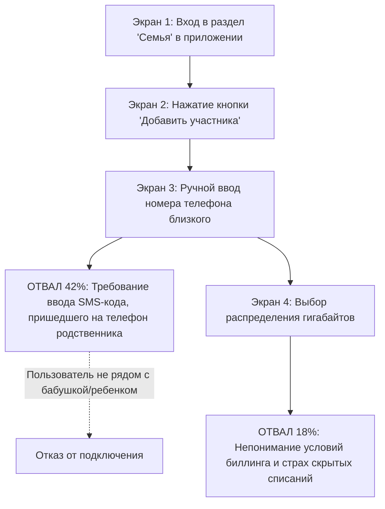
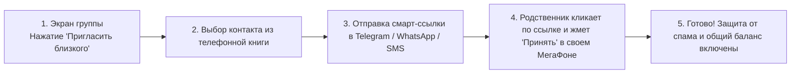

# UX & Customer Journey Analysis: «МегаФон Семья»

**Продукт**: «МегаФон Семья» (Фабрика продуктов МегаФона)  
**Автор**: Захар (Solo Maker)  
**Основание**: Исследование фактических интерфейсов и барьеров конверсии (отчет Habr / телеком UX)  
**Статус**: Готово к реализации  

---

## 1. Текущий путь пользователя (As-Is Journey) и точки отвала

### Главные интерфейсные дефекты текущей версии:
1. **Синхронный SMS-барьер**: Требование подтверждения кодом в течение 60 секунд. Если ребенок в школе, а пожилой родитель не умеет читать SMS, процесс срывается.
2. **Когнитивная перегрузка**: Ползунки лимитов гигабайтов на каждого участника пугают организатора необходимостью постоянного администрирования.
3. **Отсутствие информации о конфиденциальности**: Абонент не понимает, станет ли видна организатору история его звонков.

---

## 2. Целевой путь пользователя (To-Be Journey: Инвайт-ссылка)

### Ключевые UX-решения To-Be:
1. **Асинхронный инвайт**: Ссылка активна в течение 48 часов. Родственник может подтвердить подключение в удобный момент без пересылки одноразовых паролей.
2. **Баннер конфиденциальности на экране согласия**: Четкое текстовое пояснение по стандарту `sasha`:
   > *«Организатор оплачивает связь и защищает ваш номер от спама. Ваши звонки, SMS и история браузера остаются строго конфиденциальными и никому не видны».*
3. **Пресет «Все включено»**: Автоматическое подключение умных часов и детских симок с готовыми оптимальными настройками без необходимости ручной регулировки мегабайтов.

