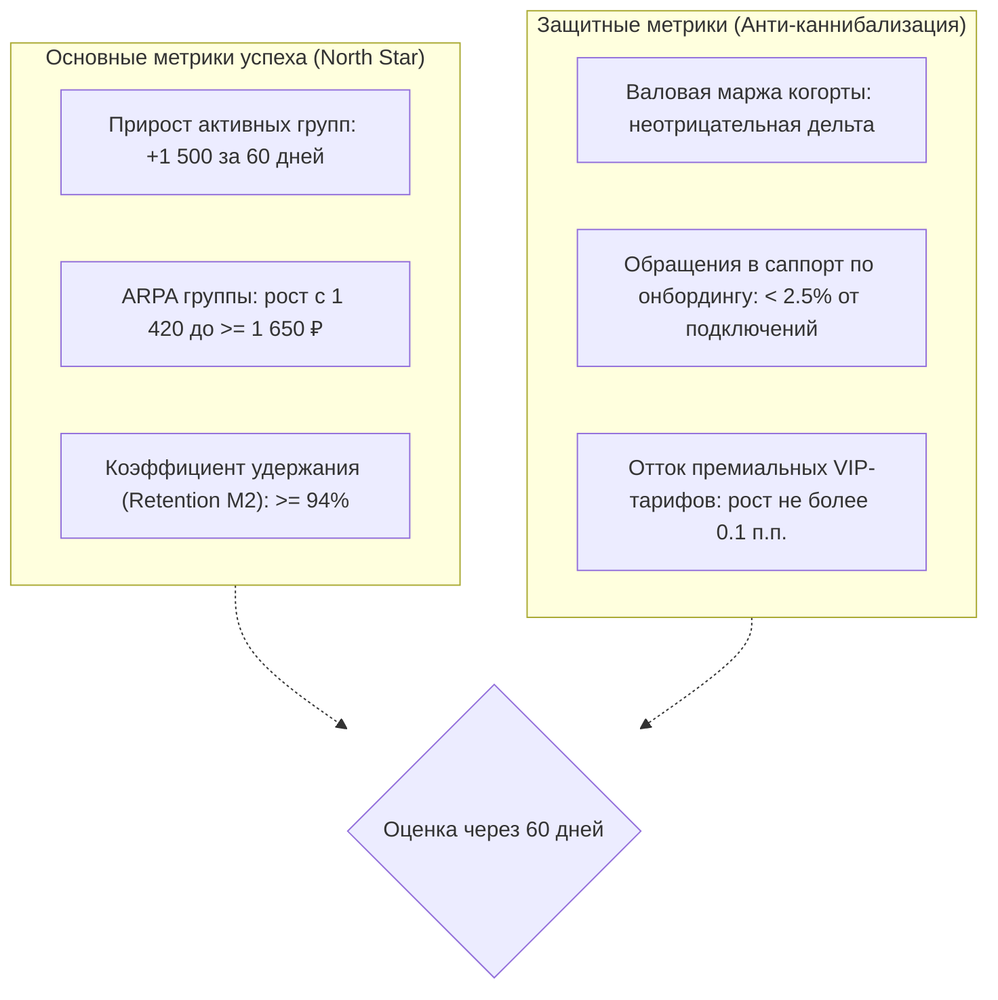

# План валидации стратегии: МегаФон Семья 2.0

**Продукт**: «МегаФон Семья» (Фабрика продуктов МегаФона)  
**Автор**: Захар (Solo Maker)  
**Окно наблюдения**: 60 дней (8 недель пилотного когортного мониторинга)  
**База для сравнения**: Данные 3 квартала 2026 г. (4 000 активных групп)  
**Статус**: Утвержден к запуску  

---

## 1. Проверяемые гипотезы (Hypothesis Register)

| ID | Проверяемая гипотеза [HYPOTHESIS] | Целевой бенчмарк | Порог фальсификации (Критерий провала) |
| :--- | :--- | :--- | :--- |
| **H1** | Внедрение онбординга по ссылке-инвайту повысит конверсию из клика по баннеру в активное объединение номеров с 12% до не менее 22%. | Конверсия $\ge 22\%$ | Конверсия $\le 15\%$ (означает, что барьер доверия не устранен). |
| **H2** | Позиционирование «автоматическая защита от спама и подписок» привлечет в семейные группы не менее 2 000 пользователей из базы мульти-SIM (конверсия 5% из 40K). | Прирост $+2\,000$ групп | Прирост $< 1\,000$ групп за 60 дней пилота. |
| **H3** | Включение детских смарт-часов по льготной ставке 99 ₽/мес снизит ежемесячный отток когорты с 1.8% до $\le 1.1\%$. | Churn $\le 1.1\%$ | Churn $\ge 1.5\%$ (отсутствие эффекта удержания). |

---

## 2. Дизайн пилотного эксперимента

- **Тестовая когорта (Treatment)**: 20 000 домохозяйств из базы мульти-SIM пилотного региона, получающих новый интерфейс онбординга с фокусом на защиту от спама и подключение смарт-часов.
- **Контрольная когорта (Control)**: 20 000 сопоставимых домохозяйств с мульти-SIM, видящих стандартный интерфейс МегаФон Семья с прежним позиционированием «скидка на пакет».
- **Длительность теста**: 8 полных недель с еженедельным снятием срезов.

---

## 3. Дашборд метрик и монитор негативных эффектов

### Защита от каннибализации (Guardrail Check):
- Если при переходе абонентов в семейную группу суммарная выручка по их номерам падает более чем на 15%, алгоритм автоматически предлагает расширенный пакет гигабайтов или доп. опцию для компенсации разницы.

---

## 4. Управленческие правила принятия решений (Decision Rules)

1. **МАСШТАБИРОВАНИЕ (Scale)**: Если за 60 дней прирост активных групп превышает $+1\,500$ при удержании ARPA $\ge 1\,650$ ₽ и Churn $\le 1.1\%$ $\to$ Немедленное тиражирование на все макрорегионы РФ.
2. **ИТЕРАЦИЯ (Iterate)**: Если прирост составляет $800\text{–}1\,200$ групп, но NPS защитных функций выше 65 $\to$ Оптимизация push-коммуникаций и продление теста на 30 дней.
3. **ОТКАТ / ЗАКРЫТИЕ (Abort)**: Если прирост $< 600$ групп или маржинальность когорты снизилась более чем на 5 млн ₽ $\to$ Активация Варианта Б (плановое закрытие направления).

