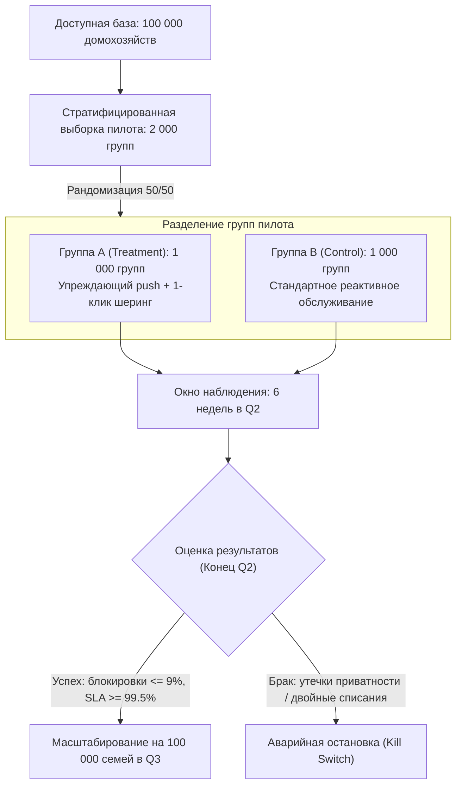

# План валидации стратегии: МегаФон Семья

**Проект**: `demo-megafon`  
**Заказчик**: Фабрика продуктов МегаФона  
**Конкурсный трек**: MGIMO AI Challenge 2026 («Стратег Фабрики продуктов»)  
**Автор**: Захар (Solo Maker)  
**Горизонт пилота**: 6 недель во втором квартале (май — июнь)  
**База для сравнения (Baseline)**: Данные базового года (оценка 275 млн ₽ валовой прибыли, 4 000 активных групп, 42% активации за 14 дней, 12% доля блокировок)  
**Статус**: Утвержденный протокол контролируемого эксперимента [APPROVED]  

---

## 1. Реестр проверяемых продуктовых гипотез

| ID | Формулировка гипотезы [HYPOTHESIS] | Целевой бенчмарк (Успех) | Порог фальсификации (Критерий провала) | Метод проверки и источник данных |
| :--- | :--- | :---: | :---: | :--- |
| **H1** | Упреждающий push-сигнал при остатке трафика $<10\%$ снизит долю номеров с ограничением интернета в течение 7 дней с 12% до $\le 9\%$. | **$\le 9.0\%$** (-3 п.п. / -25%) | $\ge 11.2\%$ (статистически незначимое изменение) | Логи сессий передачи данных и блокировок биллинга МегаФона. |
| **H2** | Кнопка быстрого шеринга «Добавить 2 ГБ» в 1 клик обеспечит долю успешных операций в установленный срок ($\le 5$ сек) не менее 99.5%. | **$\ge 99.5\%$** (SLA) | $< 98.0\%$ (технический брак транзакций) | Логи брокера push-событий и транзакций списания из общего пула. |
| **H3** | Предотвращение перебоев связи повысит долю активаций созданных групп за 14 дней с 42% (факт базового года) до $\ge 60\%$. | **$\ge 60.0\%$** | $< 48.0\%$ (барьер активации не снят) | Когортный анализ поведения новых групп в первые 14 дней жизни. |
| **H4** | Устранение стресса перебоев увеличит среднее удержание участников на $+1.6$ месяца, обеспечивая выход на темп 12 000 доп. месяцев по 500 ₽ (+6 млн ₽ валовой прибыли). | **$+1.6$ мес / номер** ($+500$ ₽/мес) | $< +0.5$ мес (отсутствие влияния на отток) | Помесячный финансовый срез удержания абонентов когорты. |

---

## 2. Дизайн контролируемого пилотного эксперимента (A/B Test Design)

### Параметры формирования выборки
- **Общий размер выборки**: **2 000 семейных групп** (около 5 000 активных номеров), отобранных из доступной базы 100 000 домохозяйств.
- **Стратификация групп**: Выборка балансируется по двум критическим параметрам:
  1. *Размер группы*: 2 номера (45%), 3 номера (35%), 4+ номеров (20%).
  2. *Среднемесячное потребление общего пакета*: низкое ($<15$ ГБ), среднее (15–35 ГБ), высокое ($>35$ ГБ).
- **Изоляция групп**: Участники группы A и группы B не информируются о наличии альтернативного интерфейса.

---

## 3. Дашборд метрик пилота и контрольные пороги

### 3.1 Основные метрики пользы и надежности
| Метрика | Формула расчета | Базовое значение | Цель пилота | Минимальный значимый эффект (MDE) |
| :--- | :--- | :---: | :---: | :---: |
| **Доля блокировок интернета** | $\frac{N_{\text{блокировок в течение 7 дней}}}{N_{\text{номеров с остатком } < 10\%}} \times 100\%$ | 12.0% | **9.0%** | $\Delta \ge 2.0$ п.п. при $p < 0.05$ |
| **Технический SLA шеринга** | $\frac{N_{\text{успешных операций без ошибок}}}{N_{\text{всех запросов на шеринг}}} \times 100\%$ | 94.0% | **$\ge 99.5\%$** | Ошибки $< 0.5\%$ |
| **Скорость исполнения операции** | Время от клика организатора до зачисления пакета на номер | $\sim 45$ сек | **$\le 5.0$ сек** | 95-й перцентиль $\le 7$ сек |
| **Доля активаций за 14 дней** | $\frac{N_{\text{активных групп через 14 дней}}}{N_{\text{созданных групп в когорте}}} \times 100\%$ | 42.0% | **$\ge 60.0\%$** | $\Delta \ge 10.0$ п.п. |

### 3.2 Защитные метрики (Guardrail Metrics) и монитор нежелательных последствий
| Защитная метрика | Допустимый порог нормы | Критический порог (Триггер тревоги) | Регламент реагирования |
| :--- | :---: | :---: | :--- |
| **Ложные предупреждения** | $< 1.0\%$ от всех пушей | $\ge 2.5\%$ | Корректировка порога детекции в аналитическом сервисе. |
| **Двойные списания / вычеты** | **0.0% (Zero-Tolerance)** | $\ge 1$ инцидент | **Немедленная блокировка кнопки шеринга**. Аудит биллинга. |
| **Утечка приватности при отзыве прав** | **0.0% (Zero-Tolerance)** | $\ge 1$ инцидент | **Полная остановка пилота**. Отзыв сессий организаторов. |
| **Обращения в КЦ по семейным тарифам** | $< 1.5\%$ от участников | $\ge 3.0\%$ | Временная приостановка промо-кампании, доработка текстов. |

---

## 4. Регламент принятия управленческих решений (Decision Gates)

### 4.1 Решение конца Q1 (Старт разработки и пилота)
- **Условие одобрения**: Успешное моделирование логики триггера на исторических логах биллинга показало точность детекции перебоя $>90\%$, и согласована схема раздельных согласий.
- **Действие**: Выделение 3 человеко-месяцев разработки и 1 человеко-месяца QA на второй квартал.

### 4.2 Решение конца Q2 (Итоги пилота и масштабирование)
По итогам 6 недель пилота руководитель направления совместно с финансовой командой принимает одно из трех детерминированных решений:

1. **МАСШТАБИРОВАНИЕ (Scale-Up)**:
   - *Условие*: Доля блокировок снизилась до $\le 9.0\%$, технический SLA $\ge 99.5\%$, критических дефектов приватности 0, темп удержания подтверждает выход на 12 000 доп. месяцев.
   - *Решение*: Масштабирование сервиса на всю базу 100 000 домохозяйств в Q3, начало интеграции сценария мульти-SIM устройств.
2. **КОРРЕКТИРОВКА (Iterate & Refine)**:
   - *Условие*: Доля блокировок снизилась до $9.5\text{–}10.5\%$, но SLA стабилен и жалоб клиентов нет.
   - *Решение*: Продление пилота на 3 недели, оптимизация формулировок push-сообщений и времени доставки.
3. **ОСТАНОВКА (Abort & Terminate)**:
   - *Условие*: Доля блокировок не изменилась ($\ge 11.5\%$), либо зафиксированы неустранимые сбои биллинга с двойными списаниями.
   - *Решение*: Закрытие пилота, фиксация базы на уровне Status Quo (279 млн ₽), перевод разработчиков на другие проекты Фабрики.
